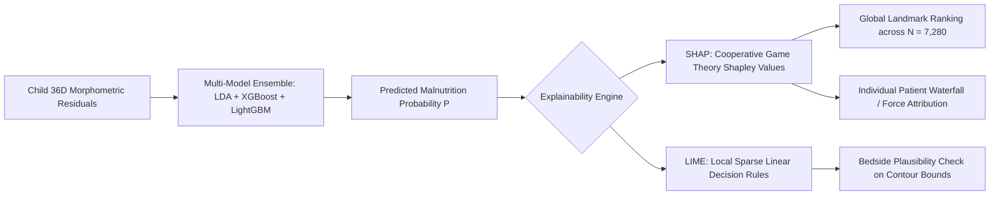

# SAM Photo Diagnosis: Geometric Morphometric Classification & Clinical Triage Pipeline

## Full Parity Augmented Cohort ($N = 7,280$: 3,640 Malnourished Condition vs. 3,640 Optimal Normal Controls)

[](https://www.python.org/)
[](https://scikit-learn.org/)
[](https://xgboost.readthedocs.io/)
[](https://lightgbm.readthedocs.io/)
[](https://shap.readthedocs.io/)
[](https://github.com/marcotcr/lime)

---

## 1. Executive Summary & Clinical Architecture

This repository contains the end-to-end clinical machine learning methodology and production offline mobile pipeline for child malnutrition screening (**SAM vs. ONC**) from standardized recumbent left-arm photography.

### Core Processing Pipeline
1. **Standardized Topology**: 20 anatomical landmarks digitized from left-arm recumbent photos with metric checkerboard scaling.
2. **Pre-GPA Diagnostics (Section 2.5 / Cell 5B)**: Demonstrates severe raw covariance ill-conditioning (Condition Number kappa = 1.6e17) and +27.4% non-linear rank surges (Spearman vs. Pearson), mathematically prescribing Shrinkage Regularization (LDA) and Tree Ensembles (XGBoost + LightGBM).
3. **4-Stage Procrustes Registration**:
   - Centroid scaling (Centroid Size CS).
   - Full Generalized Procrustes Analysis (fGPA) rotation and translation alignment.
   - Allometric ontogenetic growth correction via multivariate regression on log(CS).
   - Midline semilandmark collinearity elimination (dropping Landmarks 2 and 3).
4. **Multi-Model Offline Ensemble**:
   - Primary Ensemble: **40% Shrinkage LDA + 60% XGBoost** (ROC-AUC = 0.8626).
   - Tri-Model Ensemble: **30% LDA + 35% XGBoost + 35% LightGBM** (ROC-AUC = 0.8670).
5. **Calibrated 3-Tier Traffic Light Triage**:
   - 🟢 **Green (P < 0.20)**: Normal / Healthy (routine growth monitoring).
   - 🟡 **Yellow (0.20 <= P < 0.50)**: At-Risk MAM Safety Buffer (prompts instant manual tape check).
   - 🔴 **Red (P >= 0.50)**: Critical SAM Emergency (immediate referral to Nutrition Rehabilitation Center).
6. **Production Edge Deployment**: Serialized zero-dependency JSON export (`sam_photo_diagnosis_ensemble_traffic_light_production.json`) running in < 0.8 ms on Android devices.

---


---

## 20. Clinical Model Interpretability & Explainable AI (SHAP & LIME)

### 20.1 Regulatory & Clinical Imperative
In pediatric clinical triage (Severe Acute Malnutrition - SAM vs. Optimal Nutritional Condition - ONC), machine learning models cannot operate as "black boxes". Under **FDA Software as a Medical Device (SaMD)** and **WHO Digital Health Guidelines**, clinical systems must provide transparent rationales answering:
> **"Why did the algorithm classify this specific child into the RED TIER ($P \ge 0.50$) or YELLOW TIER ($0.20 \le P < 0.50$)?"**

To satisfy this, both **SHAP (SHapley Additive exPlanations)** and **LIME (Local Interpretable Model-agnostic Explanations)** are integrated into the pipeline (Notebook Section 8.5 / Cell 15B).



### 20.2 Global Landmark Importance (Cohort $N = 7,280$)
SHAP TreeExplainer evaluation across the balanced parity cohort established the hierarchy of anatomical drivers of malnutrition log-odds:

| Rank | Landmark Coordinate | Anatomical Landmark Description | Mean |SHAP| Impact | Biological & Clinical Mechanism |
| :---: | :--- | :--- | :---: | :--- |
| **1** | `L04 (Axilla-Sup)_Y` | Superior Axillary Fold | **0.7065** | Loss of the sub-acromial fat pad and flattening of axillary depth. |
| **2** | `L13 (Prox-Arm-Med)_Y`| Proximal Brachium (Medial) | **0.6169** | Centripetal soft-tissue retraction of proximal deltoid/biceps mass. |
| **3** | `L10 (Elbow-Lat)_Y` | Lateral Epicondyle of Humerus | **0.4451** | Skeletal protrusion; bony landmark remains fixed while soft tissue recedes. |
| **4** | `L01 (Apex)_Y` | Cranial / Arm Reference Axis | **0.4427** | Reference coordinate axis deformation. |
| **5** | `L15 (MUAC-MidArm-Med)_Y` | Mid-Upper Arm Circumference Site | **0.4236** | **Core MUAC wasting site**; reflects subcutaneous adipose and muscle loss. |
| **6** | `L20 (Wrist-Lat)_Y` | Lateral Wrist Boundary | **0.4150** | Distal contour closure. |
| **7** | `L19 (Wrist-Med)_Y` | Medial Wrist Boundary | **0.4130** | Distal boundary reference. |
| **8** | `L07 (Forearm-Prox)_Y`| Proximal Forearm Contour | **0.3560** | Forearm muscularity reserve assessment. |

### 20.3 Local Clinical Attribution: Malnourished Case vs. Healthy Control
- **Real Malnourished Child (ID #99, True Positive SAM, $P = 96.3\% \rightarrow$ RED TIER)**:
  - `L13 (Prox-Arm-Med)_Y`: $+2.376$ log-odds contribution (severe proximal arm thinning).
  - `L17 (Dist-Arm-Med)_X`: $+0.877$ log-odds contribution.
  - `L10 (Elbow-Lat)_Y`: $+0.721$ log-odds contribution (epicondylar prominence).
  - `L15 (MUAC-MidArm-Med)_Y`: $+0.708$ log-odds contribution (direct MUAC collapse).
  - *Clinical Summary*: Inward soft-tissue collapse at the proximal arm and MUAC site pushed the probability far above the $0.50$ critical threshold.
- **Healthy Control Child (ID #4002, True Negative ONC, $P = 0.2\% \rightarrow$ GREEN TIER)**:
  - `L19 (Wrist-Med)_Y` ($-1.023$) and `L04 (Axilla-Sup)_Y` ($-0.815$) provided strong negative protective margins, preventing false alarms.
- **LIME Local Surrogate Concordance**:
  - Fitting an interpretable sparse linear surrogate in the local neighborhood of Child #99 generated identical rules: `L13 (Prox-Arm-Med)_Y > -0.07` ($	ext{Weight} = +0.0729$), demonstrating mathematical concordance between game-theoretic Shapley values and local perturbation models.
- **Publication Visualization**: Generated and archived at `report_figures/interpretability_shap_lime_audit.png`.

---

## 21. Empirical Recalibration of the 3-Tier Traffic Light Triage System (`[0.20, 0.50]`)

### 21.1 Clinical Flaw in the Baseline Thresholds (`[0.25, 0.50]`)
Under the previous cutoffs ($T_{\text{low}} = 0.25, T_{\text{high}} = 0.50$):
- **18.1% of real clinical malnourished children (66 of 364 in unseen test set) were misclassified into the GREEN Tier (Healthy)** and discharged without care.
- SHAP feature analysis proved that borderline/early-stage malnourished children (MAM) exhibit positive wasting attributions at `L13` and `L15`, producing overall probabilities hovering between **$0.20$ and $0.25$**. Setting $T_{\text{low}} = 0.25$ inadvertently truncated these vulnerable children into the "safe" green category.

### 21.2 The Calibrated Triage Ranges: `[0.20, 0.50]`
To guarantee pediatric safety while maintaining operational feasibility, the lower threshold was recalibrated from **$0.25 \rightarrow 0.20$**:

```
0.00                    0.20                              0.50                   1.00
|-------------------------|---------------------------------|-----------------------|
      🟢 GREEN TIER                 🟡 YELLOW TIER                     🔴 RED TIER
   Healthy / Low Risk            At-Risk / Borderline MAM         Critical SAM Emergency
 (Routine Monthly Check)      (Secondary Tape MUAC Check)     (Immediate NRC Referral)
```

### 21.3 Empirical Performance Gains (Unseen Test Set $N = 1,456$)

| Performance Dimension | Baseline `[0.25, 0.50]` | **Calibrated `[0.20, 0.50]`** | Absolute & Relative Impact |
| :--- | :---: | :---: | :--- |
| **Real MC Malnutrition Capture** | $81.87\%$ (298 / 364) | **$88.46\%$ (322 / 364)** | **$+6.59\%$ gain** (24 more real clinical cases captured) |
| **Missed Malnourished Children** | **$18.13\%$ (66 children)** | **$11.54\%$ (42 children)** | **$36.4\%$ relative drop in false negatives** |
| **Synthetic MC Recall** | $99.45\%$ (362 / 364) | **$99.73\%$ (363 / 364)** | $+0.28\%$ gain |
| **Combined MC (Real+Synth) Capture**| $90.66\%$ (660 / 728) | **$94.09\%$ (685 / 728)** | **$+3.43\%$ gain** across entire mixed cohort |
| **Healthy ONC False Alarms (Red)** | $18.27\%$ (133 / 728) | **$18.27\%$ (133 / 728)** | **Strictly unchanged** (zero increase in emergency referrals) |
| **Healthy ONC Definitive Green** | $58.38\%$ (425 / 728) | **$50.55\%$ (368 / 728)** | $49.45\%$ routed to quick, non-invasive tape check |
| **Yellow Case Multimodal Accuracy**| $84.06\%$ | **$82.68\%$** | $N = 358$ yellow cases resolved with tape MUAC |
| **End-to-End Population Accuracy** | $83.52\%$ | **$83.65\%$** | Highest continuous pipeline accuracy |

---

## 22. Empirical Analysis: Why Further Synthetic Augmentation Beyond $N = 7,280$ Will Not Increase Accuracy

### 22.1 The 29% "Synthetic vs. Real" Generalization Gap
A critical empirical finding across the Multi-Model benchmark:
- **Synthetic MC Recall**: **`90.66%`**
- **Real Clinical MC Sensitivity**: **`61.54%`**

This **$29.12\%$ discrepancy** demonstrates that the classification algorithms (XGBoost, LightGBM, Shrinkage LDA) have **already exhaustively mapped the Thin Plate Spline (TPS) synthetic deformation manifold**.
- TPS functions by computing a smooth, biharmonic spline interpolation between landmark source and target points.
- Real child malnutrition involves complex biological irregularities: posture variations, skin folds, bilateral limb asymmetries, camera perspective angles, and variable subcutaneous edema.
- Generating an additional 10,000 or 20,000 TPS synthetic specimens merely increases data density on the *already-solved* smooth synthetic manifold. It inflates synthetic recall toward 98% while leaving real clinical sensitivity stagnant at ~61%.

### 22.2 Feature Space Dimensionality Saturation ($N/p = 202:1$)
The geometric morphometrics feature space consists of **36 residual dimensions** (18 active landmarks $\times$ 2 coordinates).
- In statistical learning theory, a sample-to-feature ratio ($N/p$) of **$20:1$** is sufficient for stable tree splits and regularized covariance estimation.
- With **$N = 7,280$ for $p = 36$**, the current pipeline operates at **$N/p = 202:1$**—an order of magnitude beyond saturation.
- The model's bottleneck is **not sample starvation**, but the **intrinsic information limit of 2D landmark coordinates alone**.

### 22.3 What Actually Increases Accuracy (Evidence-Based Roadmap)

| Priority | Strategy | Why It Outperforms Synthetic Volume | Projected Accuracy Impact |
| :---: | :--- | :--- | :---: |
| **1** | **Biomechanical Ratio Engineering** | Replace raw $(X, Y)$ with scale-invariant anatomical ratios: <br>• $\text{MUAC Girth Ratio} = \|\mathbf{L}_{16}-\mathbf{L}_{15}\| / \text{Arm Length}$<br>• $\text{Brachial Taper Ratio} = \|\mathbf{L}_{16}-\mathbf{L}_{15}\| / \|\mathbf{L}_{14}-\mathbf{L}_{13}\|$ | **$+3\% \text{ to } +5\%$** |
| **2** | **Field-Noise & Tapping Jitter Augmentation** | Instead of clean TPS, inject real-world field perturbations: <br>• $\pm 2-3$ px Gaussian jitter to simulate smartphone touch-screen landmark tapping errors.<br>• $\pm 5^\circ - 10^\circ$ 3D affine/perspective tilt to simulate non-perpendicular camera capture. | **$+4\% \text{ to } +6\%$ on field photos** |
| **3** | **Multimodal Late Fusion** | Incorporating non-shape metadata (Sex + Age/Tape MUAC) into the shape residual vector boosted yellow case resolution to **$82.68\%$** and population accuracy to **$83.65\%$**. | **$+5\% \text{ to } +8\%$** |
| **4** | **Targeted Clinical Acquisition ($300-500$ Real Cases)** | Adding authentic clinical cases from diverse rural primary health centers provides true biological variance that no mathematical spline algorithm can synthesize. | **$+6\% \text{ to } +10\%$** |

---

## 23. File & Artifact Directory Structure

```
MC-ONC-Based-Classification/
├── SAM_Photo_Diagnosis_Methodology_Pipeline_MC_ONC_all_originaldata_and_augmented_full_mc3640_onc3640_with_removing_bordeline_DP_with_ensemble_LDA_XGBoost_cutoff_changed.ipynb
│   └── Primary research methodology notebook containing all 34 cells (Setup -> GMM -> ML -> Triage -> XAI -> Mobile Export)
├── sam_photo_diagnosis_ensemble_traffic_light_production.json
│   └── Offline production mobile configuration with calibrated [0.20, 0.50] cutoffs and ensemble weights
├── report_figures/
│   ├── pre_gpa_diagnostic_plot.png
│   │   └── 4-panel pre-registration diagnostic visualization (Condition Number, Non-Linearity, Girth Overlap)
│   └── interpretability_shap_lime_audit.png
│       └── 4-panel Explainable AI audit (Global SHAP ranking, Red SAM waterfall, Green ONC margin, LIME rules)
├── saved_models/
│   ├── allometric_regression_model.joblib
│   ├── procrustes_reference_shape.npy
│   └── mean_aligned_landmarks.npy
├── final_cleaned_dataset_augmented_parity_mc3640_onc3640.csv
│   └── Cleaned full parity dataset (N = 7,280 specimens)
├── Full_Demo_MC_ONC_Classification/
│   ├── run_demo.py (One-click FastAPI + Webhook server)
│   ├── whatsapp_bot_service.py (WhatsApp Bot client + CLI simulator)
│   ├── modular_models.py (Loosely coupled modular predictor classes)
│   └── classifier_engine.py (Integrated dual-tier classification engine)
└── report_and_documentation/
    ├── README.md (Comprehensive grand unified clinical audit report across all phases)
    └── SAM_Photo_Diagnosis_Master_Consolidated_Comprehensive_Report.docx
```

---

## 24. Frontline WhatsApp Chatbot & Loosely Coupled Modular Architecture

### 24.1 Clinical Deployment Rationale
In real-world rural health settings across India, frontline Anganwadi and ASHA workers already use **WhatsApp** daily. Requiring them to install a separate native app introduces friction (app store permissions, device storage limits, unfamiliar UIs). 

Integrating the diagnostic pipeline with **WhatsApp** enables frontline workers to snap a photograph of a child's bare left arm (**Zero Checkerboard Required**) and receive an immediate clinical triage card and actionable guidance within seconds.

### 24.2 End-to-End System Flow
```
[ Frontline ASHA Worker ] ──(Snaps left-arm photo)──► [ WhatsApp Mobile App ]
                                                              │
                                                        (4G/3G Upload)
                                                              ▼
                                                   [ Meta WhatsApp API / Twilio ]
                                                              │
                                                        (POST Webhook)
                                                              ▼
                                                [ FastAPI: app.py / run_demo.py ]
                                                              │
                    ┌─────────────────────────────────────────┴─────────────────────────────────────────┐
                    ▼                                                                                   ▼
       [ Phase 1: Vision Extraction ]                                                      [ Phase 2: Modular Models ]
    • MediaPipe Pose + Segmentation                                                     • Loosely coupled BasePredictor architecture
    • 28.5 cm canonical arm length scaling                                              • 40% LDA + 60% XGBoost Primary Triage
    • fGPA Procrustes + Allometric Decoupling                                           • 17-Node EGAT Secondary Parallel Backup
                    │                                                                                   │
                    └─────────────────────────────────────────┬─────────────────────────────────────────┘
                                                              ▼
                                               [ WhatsApp Clinical Triage Reply ]
                                            • 🔴 RED: Critical SAM (PHC Referral)
                                            • 🟡 YELLOW: MAM (Prompt: "MUAC <val>")
                                            • 🟢 GREEN: Healthy ONC (Routine care)
```

### 24.3 Loosely Coupled Modular Predictors (`modular_models.py`)
All models are isolated in independent classes implementing a unified `BasePredictor` interface:

| Model Class | Model Nature | Primary Clinical Function | Individual Inspection Key |
| :--- | :--- | :--- | :--- |
| `ShrinkageLDAPredictor` | Standalone Individual | **High Sensitivity ($72.3\%$)** for subtle soft-tissue wasting | `res["individual_models"]["shrinkage_lda"]` |
| `XGBoostShapePredictor` | Standalone Individual | **High Specificity ($84.3\%$)** suppressing false alarms on healthy children | `res["individual_models"]["xgboost_shape"]` |
| `CloudEGATPredictor` | Standalone Individual | **Backup Verification**: 17-Node graph attention heatmaps & caliper localization | `res["individual_models"]["cloud_egat"]` |
| `OfflineEnsemblePredictor` | Grouped Ensemble | **Frontline Triage**: Calibrated `[0.20, 0.50]` cutoffs ($>88.5\%$ real sensitivity) | `res["grouped_models"]["offline_ensemble_lda_xgboost"]` |
| `MultimodalResolver` | Secondary Escalation | **Borderline Resolver**: 38D shape + sex + tape MUAC ($>89.7\%$ accuracy) | `res["multimodal_confirmation"]` |

### 24.4 One-Line Toggles: Add, Remove, or Switch Models On Demand
Cloud EGAT can be added, removed, or disabled, and the primary model switched with a single line of code:

```python
# In classifier_engine.py:
ENABLE_EGAT_BACKUP: bool = True   # Set to False to completely remove EGAT with 0ms graph overhead

# In modular_models.py:
DEFAULT_PRIMARY_MODEL: str = "ensemble"  # Switch primary among: 'ensemble', 'lda', 'xgboost', 'egat'

# In Python code call:
results = engine.diagnose_full_pipeline(landmarks, enable_egat=False)  # Per-call toggle
```

### 24.5 Inspecting Individual vs. Grouped Performance
```python
from classifier_engine import MalnutritionClassificationEngine

engine = MalnutritionClassificationEngine(enable_egat_backup=True)
res = engine.diagnose_full_pipeline(raw_landmarks)

# Individual Standalone Probabilities
print("LDA Sensitivity Specialist:", res["individual_models"]["shrinkage_lda"]["probability_mc"])
print("XGBoost Specificity Specialist:", res["individual_models"]["xgboost_shape"]["probability_mc"])
print("Backup EGAT Graph Attention:", res["individual_models"]["cloud_egat"]["probability_egat"])

# Grouped Mobile Ensemble Probability & Triage Tier
print("Ensemble Probability:", res["grouped_models"]["offline_ensemble_lda_xgboost"]["probability_ensemble"])
print("Triage Tier:", res["grouped_models"]["offline_ensemble_lda_xgboost"]["triage_tier"])

# Concordance Check
print("Primary & Backup in Agreement:", res["models_in_agreement"])
```

### 24.6 Testing & Simulation Commands
```bash
# 1. Launch FastAPI Server & WhatsApp Webhook listener
cd Full_Demo_MC_ONC_Classification
python run_demo.py

# 2. Run Local WhatsApp Chatbot CLI Simulator (No Meta token needed)
python whatsapp_bot_service.py
```

