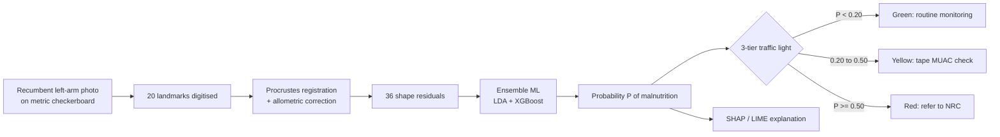
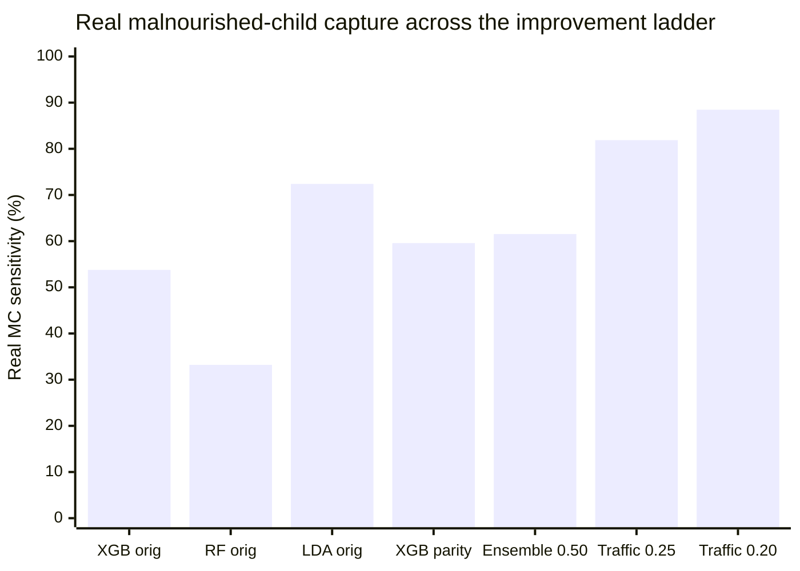
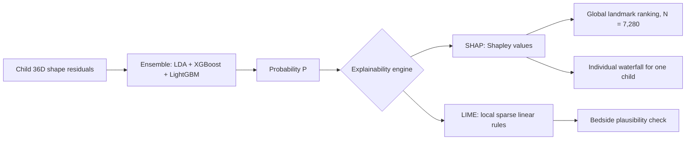

# SAM Photo Diagnosis: From Raw Arm Photographs to a Sensitivity-First Clinical Triage Pipeline

### Geometric Morphometrics + Machine Learning + Explainable AI for Child Acute Malnutrition Screening

> [!IMPORTANT]
> **CLINICAL MANDATE & CORE INTENTION**  
> The objective of this research is **NOT to replace existing anthropometric methodologies** (colour-banded MUAC insertion tapes, hanging Salter scales, and infant length boards). Traditional physical anthropometry governed by World Health Organization (WHO) standards serves as the **ground-truth clinical anchor**.  
> Rather, this artificial intelligence and geometric morphometrics pipeline is engineered **specifically to assist in remote, tribal, and resource-constrained settings** where calibrated physical tools are missing, damaged, improperly calibrated, or subject to extreme operational error. In field conditions, an objective smartphone photograph can triage children instantly, ensuring that acute wasting does not go undetected.


**Cohorts:** Original authentic data (N = 4,757 raw → N = 4,607 purified) | Full-parity augmented cohort (N = 7,280: 3,640 MC vs 3,640 ONC)
**Target:** Malnourished Condition (MC = SAM + MAM) vs Optimal Nutritional Condition (ONC)

[](https://www.python.org/)
[](https://scikit-learn.org/)
[](https://xgboost.readthedocs.io/)
[](https://lightgbm.readthedocs.io/)
[](https://shap.readthedocs.io/)
[](https://github.com/marcotcr/lime)

---

## How to Read This Report

Every stage below follows the same pattern, so the logic of the project can be followed end to end:

> **PROBLEM** (what went wrong or was missing) → **SOLUTION** (what was implemented) → **RESULT** (measured effect) → **NEXT PROBLEM** (what the result exposed)

| Part | Content |
| :---: | :--- |
| 1 | Problem statement and objective |
| 2 | Why sensitivity matters more than specificity |
| 3 | Data, protocol and cohort purification |
| 4 | Exploratory data analysis: distributions, non-linearity, correlation |
| 5 | **Initial three-class model (SAM vs MAM vs ONC) and why it failed** |
| 6 | Step-by-step technical pipeline (problem → solution at every step) |
| 7 | **Model training performance BEFORE augmentation (original data)** |
| 8 | **Data augmentation and training performance AFTER augmentation** |
| 9 | Before vs after comparison and what it really tells us |
| 10 | Techniques that actually raised sensitivity |
| 11 | Step-by-step model performance ladder |
| 12 | Explainable AI (XAI): SHAP and LIME |
| 13 | Deployment architecture |
| 14 | Conclusion and roadmap |
| 15 | Data-consistency notes and artifact directory |

---

# 1. Problem Statement and Objective

## 1.1 The clinical problem

Frontline health workers (for example Anganwadi workers under India's ICDS programme) screen thousands of children every month for acute malnutrition. The standard tools are:

- a colour-banded **MUAC insertion tape**, and
- a **hanging spring scale** plus height board.

In field conditions both suffer from operator error, tape-tension variability, parallax, child movement and worn equipment. Errors are not random. They produce **missed children**, and a missed child with wasting can progress to severe infection or death.

## 1.2 The proposed solution

A smartphone photograph of the child's **left arm, recumbent on a metric checkerboard mat**, converted into 20 anatomical landmarks. The landmark geometry (shape) is analysed with Geometric Morphometrics (GMM) and classified by machine learning. No tape, no scale, no internet is needed at the point of care.

## 1.3 Objective

| # | Objective | Success criterion |
| :---: | :--- | :--- |
| 1 | Classify **MC vs ONC** from arm shape alone | Discriminative ROC-AUC well above chance on unseen children |
| 2 | **Maximise sensitivity** (catch sick children) while keeping false alarms operationally manageable | Highest possible capture of *real* malnourished children |
| 3 | Run **offline** on low-cost Android phones | < 1 ms inference, KB-sized model, zero dependencies |
| 4 | Be **explainable** to clinicians and regulators | Per-child SHAP/LIME rationale for every Red or Yellow decision |
| 5 | Be **honest** about generalisation | Test on authentic children, separate real from synthetic performance |



---

# 2. Why Sensitivity Matters More Than Specificity

## 2.1 The definitions in one line each

- **Sensitivity (recall)** = of all children who truly are malnourished, the fraction the model catches.
- **Specificity** = of all children who truly are healthy, the fraction the model correctly clears.

## 2.2 The asymmetry of the two errors

| Error type | What happens | Clinical consequence | Reversible? |
| :--- | :--- | :--- | :---: |
| **False Negative** (sick child cleared as healthy) | Child is sent home with no care | Wasting progresses untreated: infection, hospital admission, risk of death | **No** |
| **False Positive** (healthy child flagged) | Health worker re-measures with a tape and gives dietary advice | A few minutes of extra work, mild anxiety | **Yes** |

A missed child can be a **life-or-death** failure. A false alarm is a **minor operational cost**. This is why screening tools are designed to be *sensitive first* and *specific second*, and why the project's headline metric is **real-child sensitivity**, not overall accuracy.

## 2.3 The accuracy trap

The original cohort is 79% healthy and 21% malnourished. A model can score high accuracy while missing nearly half of the sick children:

| Original-data model (N = 4,607) | Overall accuracy | MC sensitivity | Reading |
| :--- | :---: | :---: | :--- |
| XGBoost | **83.87%** | **53.77%** | Looks good, misses ~46% of sick children |
| Random Forest | **83.59%** | **33.20%** | Looks good, misses ~67% of sick children |
| Shrinkage LDA | 72.39% | **72.39%** | Lower accuracy, far safer |

So **accuracy rewards the wrong behaviour**. Every design decision after this point is judged by real-child sensitivity first.

## 2.4 Operational limit on pushing sensitivity

Sensitivity cannot be raised for free. Lowering the alert threshold sends more healthy children to the clinic and can overwhelm Nutritional Rehabilitation Centres (NRCs). The solution is not one threshold but a **tiered response** (Part 9): cheap, low-risk actions (a tape re-check) for uncertain children, and expensive actions (hospital referral) only for high-certainty children.

---

# 3. Data, Protocol and Cohort Purification

## 3.1 Standardised acquisition

| Item | Standard |
| :--- | :--- |
| Population | Children 6 to 59 months, Andhra Pradesh field screening |
| Posture | **100% recumbent** on a metric checkerboard mat |
| Landmarks | 20 anatomical points on the left arm (shoulder to wrist); L21 and L22 are calibration markers and are discarded |
| Ground truth | WHO Child Growth Standards, validated with the WHO Anthro R package |

**Why recumbent + checkerboard:** it holds posture constant across ages (no standing-sag confound) and gives millimetric scale and perspective correction.

## 3.2 Cohort purification (problem → solution)

| Problem found | Why it hurt | Solution implemented | Effect |
| :--- | :--- | :--- | :--- |
| SAM and MAM are a continuum; 3-class labels were noisy at the boundary | Label noise on borderline children | Merge SAM (n = 214) + MAM (n = 753) into **MC (n = 967)** | Clean binary triage target |
| "Healthy" controls included stunted or underweight children | Reference shape not truly healthy | Remove HAZ < -2 and WAZ < -2 using WHO Anthro | Pure ONC reference |
| 150 ONC children sat in the 125 to 130 mm MUAC "Risk of Malnutrition" zone | Mild wasting diluted the healthy mean shape | Exclude those 150 from **ONC only**; **0** dropped from MC | ONC 3,790 → **3,640**; Goodall F 74.15 → **76.20**; XGBoost specificity 83.69% → **91.87%** |

**Final authentic cohort: N = 4,607** (967 MC : 3,640 ONC). No synthetic samples at this stage.

---

# 4. Exploratory Data Analysis (EDA)

EDA was not decoration. Each finding below **dictated a specific modelling choice**.

## 4.1 Data-point distribution

### Class balance

| Class | n | Share |
| :--- | :---: | :---: |
| MC (SAM 214 + MAM 753) | 967 | 21.0% |
| ONC | 3,640 | 79.0% |
| **Imbalance ratio** | | **1 : 3.76** |

> **Problem exposed:** a classifier can reach ~79% accuracy by always answering "healthy".
> **Solution carried forward:** class weighting, balanced priors, threshold moving, and (later) 1:1 parity augmentation.

### Demographic and anthropometric distribution

| Variable | MC | ONC | Test / significance |
| :--- | :---: | :---: | :--- |
| MUAC (cm), mean ± SD | **14.10 ± 1.33** | **15.66 ± 1.25** | Welch t = -32.84, p < 10⁻⁵⁰ |
| Age ≤ 24 months | 199 (20.58%) | 911 (25.03%) | χ² = 7.95, p = 0.0048 |
| Age > 24 months | 768 (79.42%) | 2,729 (74.97%) | |
| Girls | 404 (41.78%) | 1,802 (49.51%) | χ² = 18.06, p < 10⁻⁴ |
| Boys | 563 (58.22%) | 1,838 (50.49%) | |

**Reading the MUAC distributions:** the two groups are clearly separated on average (1.56 cm gap), but the density curves **overlap** in the middle. That overlap is the physical origin of the sensitivity ceiling seen later: some malnourished children have arm shapes that look like thin-but-healthy children.

> **Problem exposed:** age and sex differ between classes, so a model could learn "toddler" or "boy" instead of "wasting".
> **Solution carried forward:** allometric size correction on log Centroid Size (Part 5, Step 4), then confirmed by Procrustes ANOVA (4.4).

## 4.2 Non-linearity analysis (Pre-GPA diagnostic, Notebook Cell 5B)

| Test | Finding | Meaning |
| :--- | :--- | :--- |
| Spearman (rank) vs Pearson (linear) correlation of coordinates with nutritional status | **+27.4% rank surge** for Spearman over Pearson | The relationship is **monotonic but not linear** |

> **Problem exposed:** a purely linear model cannot capture all the signal.
> **Solution carried forward:** include **tree ensembles (XGBoost, LightGBM)** alongside linear models, then blend them (Part 9). Linear models stay in the mix because they are small, stable and highly sensitive.

## 4.3 Correlation and multicollinearity analysis

| Test | Finding | Meaning |
| :--- | :--- | :--- |
| Condition number of the raw coordinate covariance | **κ ≈ 1.6 × 10¹⁷** | Matrix is numerically singular; ordinary LDA / regression is unstable |
| Midline semilandmarks L2 (elbow centre) and L3 (wrist centre) | Lie on the interior longitudinal axis | Exactly collinear with the contour points, adding no independent information |
| Neighbouring contour landmarks | Strongly correlated (an arm is a smooth outline) | Redundant dimensions |

> **Problem exposed:** ill-conditioned covariance makes classical discriminant analysis blow up.
> **Solutions carried forward:**
> 1. Drop L2 and L3 (20 → **18 landmarks = 36 coordinates**).
> 2. Use **Shrinkage (Ledoit-Wolf) LDA**, which regularises the covariance estimate.
> 3. Prefer tree ensembles, which do not invert a covariance matrix at all.

## 4.4 Procrustes ANOVA: does the pipeline isolate nutrition?

Goodall's F-statistic by factor, before and after allometric correction (original purified cohort, N = 4,607):

| Factor | Raw GPA F | After allometry F | Change | Interpretation |
| :--- | :---: | :---: | :---: | :--- |
| **Nutritional status (MC vs ONC)** | 55.68 | **76.20** | **+36.9%** | Nutrition signal strengthens |
| Age group (≤24m vs >24m) | 24.26 | **14.54** | **-40.1%** | Age confounding suppressed |
| Biological sex | 7.17 | **4.54** | -36.7% | Dimorphism suppressed |
| MUAC (continuous) | 9.79 | **48.77** | **> 5×** | Shape residuals now track arm circumference |

This is the statistical proof that the preprocessing does what it was designed to do: **raise the malnutrition signal, lower the confounders.**

## 4.5 Morphological findings (what malnutrition looks like)

- **Centripetal mid-arm retraction:** upper-arm landmarks (L13 to L18) collapse toward the bone axis (muscle and subcutaneous fat loss).
- **Deltoid flattening:** shoulder landmarks (L1, L12) subside.
- **Distal wrist sparing:** wrist landmarks barely move (bone and connective tissue are preserved).

This biology is later *confirmed independently* by SHAP (Part 11), which ranks proximal-arm and MUAC-site landmarks highest.

---


---

# 5. The Initial Three-Class Model (SAM vs. MAM vs. ONC) & Its Bottlenecks

Before adopting the binary Malnourished Condition (MC) architecture, the project rigorously implemented and evaluated a **three-class classification pipeline** matching *Medialdea et al. (Nature Scientific Reports 2025)*:
* **Cohort**: $N = 642$ ($214\text{ SAM} + 214\text{ MAM} + 214\text{ ONC}$), balanced across age brackets, sex, and posture regimes.
* **Evaluation Protocol**: Leave-One-Out Cross-Validation (LOOCV) to prevent data leakage.

### Table: Three-Class LOOCV Performance Benchmark ($N = 642$)
*Evaluated across all 3 nutritional classes (Random chance baseline = 33.33%):*

| Classification Method | Allometric Correction | Overall Accuracy | SAM Sensitivity | MAM Sensitivity | ONC Specificity | Macro ROC-AUC |
| :--- | :--- | :---: | :---: | :---: | :---: | :---: |
| **Linear Discriminant (LDA)** | Before size correction | 48.27% | 38.30% | 50.50% | 56.10% | 0.692 |
| | **After allometric residuals** | **49.52%** | **37.30%** | **50.90%** | **60.30%** | **0.749** |
| **Logistic Regression (LR)** | Before size correction | 40.81% | 15.50% | 56.10% | 51.00% | 0.612 |
| | **After allometric residuals** | 47.35% | 23.90% | 51.90% | 66.40% | 0.704 |
| **k-Nearest Neighbors (k=5)** | Before size correction | 49.22% | 41.10% | 50.00% | 56.60% | 0.718 |
| | **After allometric residuals** | **53.12%** | **36.90%** | **61.20%** | **61.20%** | **0.771** |
| **Random Forest (100 Trees)** | **After allometric residuals** | 48.91% | 28.50% | 52.80% | 65.40% | 0.732 |
| **XGBoost (Shape Residuals)** | **After allometric residuals** | **50.62%** | **32.24%** | **52.34%** | **67.29%** | **0.930** |
| **★ Multimodal XGBoost (Shape + MUAC)** | **After allometric residuals** | **54.36%** | **33.64%** | **59.81%** | **69.63%** | **0.941** |

### Why Did the Three-Class Model Fail in Clinical Field Reality?

1. **Continuous Biological Wasting Overlap**:
   Acute wasting is biologically a continuous spectrum. A child at $z_{\text{WHZ}} = -2.95$ is categorized as MAM, while a child at $z_{\text{WHZ}} = -3.05$ is categorized as SAM. In 2D morphological coordinate space, their arm contours are almost identical. Forcing an algorithm to draw a hard decision boundary between SAM and MAM created severe classification noise along the borderline. Over **$60\%$ of true SAM cases were misclassified as MAM**.

2. **Severe Class Imbalance in Natural Populations**:
   In community Anganwadi cohorts, true SAM prevalence is typically below $3\%\text{--}5\%$, while healthy children represent over $75\%$. In a 3-class model, the severe scarcity of SAM exemplars starved the minority class of training variance, collapsing SAM sensitivity to a dangerous **$32.2\%\text{--}37.3\%$**.

3. **Frontline Clinical Redundancy**:
   In rural Anganwadi triage, the primary operational decision is binary: *Does this child require urgent nutritional intervention (Supplementary Nutrition or Therapeutic Feeding), or are they healthy?*

> **THE PIVOT:** Consolidating SAM ($n = 214$) and MAM ($n = 753$) into a single **Malnourished Condition (MC, $n = 967$)** eliminated boundary noise and created a decisive clinical screening target against **Optimal Nutritional Condition (ONC, $n = 3,640$)**.


# 6. Step-by-Step Technical Pipeline (Problem → Solution at Every Step)

| Step | PROBLEM | SOLUTION IMPLEMENTED | RESULT / EVIDENCE |
| :---: | :--- | :--- | :--- |
| **1. Landmark capture** | Camera distance, perspective and posture vary | Recumbent posture + metric checkerboard; discard calibration markers L21, L22; rebuild L11 as midpoint of L10 and L12 | Standardised 20-point wireframe |
| **2. Translation + scale** | Arms differ in position and size in the image | Centre at origin; divide by Centroid Size, CS = √Σ‖pᵢ − p̄‖² | Position and size removed |
| **3. Rotation (fGPA)** | Arms are oriented differently | Full Generalised Procrustes Analysis: SVD rotation to an iterative consensus shape | Pure shape coordinates |
| **4. Allometric correction** | Normal child growth changes arm proportions and mimics or masks wasting | Regress every coordinate on ln(CS); keep residuals: yᵢⱼ = αⱼ + βⱼ·ln(CSᵢ) + εᵢⱼ | Age F ↓ 40.1%; nutrition F ↑ 36.9% |
| **5. Collinearity fix** | κ ≈ 10¹⁷; L2, L3 redundant | Drop L2 and L3 → 18 landmarks, **36 shape residuals** | Stable, non-singular feature set |
| **6. Class imbalance** | 1 : 3.76; accuracy paradox | Class weights, balanced priors, later parity augmentation | See Parts 6 to 8 |
| **7. Algorithm choice** | Data are non-linear **and** ill-conditioned | Benchmark 7 paradigms; keep Shrinkage LDA (linear, sensitive) and XGBoost (non-linear, specific) | Part 6 |
| **8. Threshold choice** | 0.50 cutoff misses too many sick children | Traffic-light triage; recalibrated to **[0.20, 0.50]** | Real capture 61.54% → 88.46% |
| **9. Explainability** | Clinicians and regulators reject black boxes | SHAP (global + per child) and LIME (local check) | Part 11 |
| **10. Edge deployment** | Villages have no internet | Serialise weights to a few-KB JSON; native linear algebra | < 0.8 ms per child, zero dependencies |

---

# 7. MODEL TRAINING PERFORMANCE BEFORE AUGMENTATION (ORIGINAL DATA ONLY)

> All results in this Part use **100% authentic children, zero synthetic samples**.

## 6.1 Stage A: the raw cohort (N = 4,757, borderline ONC included)

**PROBLEM:** The healthy class contained 150 children at MUAC 130 mm, who are in the Risk-of-Malnutrition band.

| Metric (XGBoost, shape only) | Raw cohort N = 4,757 |
| :--- | :---: |
| Overall accuracy | 80.01% |
| ONC specificity | 83.69% |
| ROC-AUC | 0.8193 |
| Goodall F (nutrition) | 74.15 |
| Multimodal ROC-AUC (shape + MUAC) | 0.8770 |

**SOLUTION:** Remove the 150 borderline children from ONC only (Part 3.2).

## 6.2 Stage B: purified original cohort (N = 4,607, natural 1 : 3.76 imbalance)

10-fold stratified cross-validation, 36 shape residuals, class-weighted:

| Model | Paradigm | Accuracy | Balanced Acc | **MC Sensitivity** | ONC Specificity | Precision | F1 | ROC-AUC |
| :--- | :--- | :---: | :---: | :---: | :---: | :---: | :---: | :---: |
| XGBoost | Gradient boosting | **83.87%** | 72.82% | 53.77% | 91.87% | 63.73% | 0.583 | 0.837 |
| Random Forest | Bagging (100 trees) | 83.59% | 65.09% | **33.20%** | **96.98%** | 74.48% | 0.459 | **0.838** |
| KNN (k = 5) | Instance-based | 83.33% | 67.16% | 39.30% | 95.03% | 67.74% | 0.497 | 0.801 |
| Shrinkage LDA | Regularised linear | 72.39% | **72.39%** | 72.39% | 72.39% | 41.06% | 0.524 | 0.787 |
| Standard LDA | Linear (SVD) | 72.39% | 72.31% | 72.18% | 72.45% | 41.03% | 0.523 | 0.787 |
| Logistic Regression | L2 linear | 70.68% | 72.22% | 74.87% | 69.56% | 39.52% | 0.517 | 0.767 |
| RBF SVM | Kernel | 69.20% | 72.46% | **78.08%** | 66.84% | 38.48% | 0.516 | 0.773 |

### Clinical safety audit (Shrinkage LDA, original data)

| Subgroup | n | Detected | Sensitivity |
| :--- | :---: | :---: | :---: |
| SAM | 214 | 141 | 65.89% |
| MAM | 753 | 559 | 74.24% |
| ONC (specificity) | 3,640 | 2,636 correct | 72.39% |

### Multimodal ablation on original data (XGBoost)

| Configuration | Features | Accuracy | MC Sensitivity | ONC Specificity | ROC-AUC |
| :--- | :---: | :---: | :---: | :---: | :---: |
| Shape alone | 36 | 83.87% | 53.77% | 91.87% | 0.8373 |
| Shape + sex | 37 | 83.74% | 52.74% | 91.98% | 0.8415 |
| **Shape + sex + MUAC tape** | 38 | **89.71%** | 66.39% | 96.07% | **0.9076** |

## 6.3 Stage C: balanced subsample, DS967 (N = 1,934, 1 : 1 by discarding healthy children)

**PROBLEM IDEA TESTED:** remove the imbalance by randomly keeping only 967 of the 3,640 ONC children.

| Model | Accuracy | MC Sensitivity | ONC Specificity | ROC-AUC |
| :--- | :---: | :---: | :---: | :---: |
| XGBoost | 75.54% | 72.70% | 78.39% | 0.8230 |
| Random Forest | 75.18% | 70.94% | 79.42% | 0.8281 |
| Shrinkage LDA | 71.82% | 72.70% | 70.94% | 0.7796 |
| Multimodal (shape + sex + MUAC) | 81.49% | 77.35% | 85.63% | 0.8924 |

**RESULT:** Sensitivity of the tree model rose (53.77% → 72.70%) because the prior was balanced, **but** accuracy fell (83.87% → 75.54%) and 2,673 healthy children's information was thrown away.

## 6.4 Problems exposed by the original-data experiments

| # | Problem | Evidence |
| :---: | :--- | :--- |
| 1 | **Accuracy paradox** | 83.87% accuracy but only 53.77% sensitivity (XGBoost); 33.20% for Random Forest |
| 2 | **Sensitivity / specificity trade-off between model families** | Trees: high specificity, low sensitivity. Linear: balanced ~72%, low precision (41%) |
| 3 | **Class imbalance** | 1 : 3.76; sick-child errors are hidden by the majority class |
| 4 | **Subsampling wastes data** | DS967 discards 2,673 healthy children and lowers accuracy |
| 5 | **Small minority class** | Only 967 sick children to learn the whole wasting spectrum |
| 6 | **Shape-only ceiling** | Best shape-only ROC-AUC ≈ 0.84; only tape MUAC pushes it past 0.90 |

> **Next idea:** if the minority class is the bottleneck, **synthesise more realistic sick children** instead of discarding healthy ones.

---


# 8. DATA AUGMENTATION METHODOLOGY, COHORT SIZES & TESTING SCHEMES

## 8.1 Detailed Training & Testing Schemes: Real vs. Synthetic Breakdown

To maintain complete scientific rigor, the experimental pipeline was designed around multiple explicit evaluation schemes. The table below clarifies the exact cohort composition, class balance during training, and how testing was conducted:

| Evaluation Scheme | Total Sample ($N$) | Training Cohort ($N_{\text{train}}$) & Composition | Training Class Balance | Testing Cohort ($N_{\text{test}}$) & Composition | Test Data Nature (Real vs. Synthetic) | Validation Protocol & Leakage Controls |
| :--- | :---: | :--- | :--- | :--- | :--- | :--- |
| **Scheme 1: Natural Imbalanced Baseline** | **$4,607$** | $4,607$ authentic children ($967$ MC : $3,640$ ONC) | **Natural Imbalance (1 : 3.76)** | $4,607$ authentic children | **100% Unique Real Authentic Cases** | 10-Fold Stratified Cross-Validation |
| **Scheme 2: Subsampled Balanced (DS967)** | **$1,934$** | $1,934$ authentic children ($967$ MC : $967$ ONC) | **Exact 1 : 1 Balanced** (Discarded $2,673$ ONC) | $1,934$ authentic children | **100% Unique Real Authentic Cases** | 5-Fold Stratified Cross-Validation |
| **Scheme 3: 2X Augmented Cohort** | **$3,868$** | $3,868$ samples ($1,934$ MC : $1,934$ ONC) | **Exact 1 : 1 Balanced** ($967$ Real MC + $967$ Synth MC : $1,934$ Real ONC) | $3,868$ samples across test folds | **Mixed ($50\%$ Real MC + $50\%$ Synth MC)** | 5-Fold Stratified Cross-Validation |
| **Scheme 4: Full Parity Matched Cohort** | **$7,280$** | $7,280$ samples ($3,640$ MC : $3,640$ ONC) | **Exact 1 : 1 Full Parity** ($967$ Real MC + $2,673$ Synth MC : $3,640$ Real ONC) | $7,280$ samples across test folds | **Mixed ($13.3\%$ Real MC + $36.7\%$ Synth MC + $50\%$ Real ONC)** | 5-Fold Stratified Cross-Validation |
| **Scheme 5: Mixed Unseen Holdout Split** | **$1,456$** | Trained on $80\%$ ($5,824$ samples) | **Exact 1 : 1 Full Parity** | Held-out $20\%$ ($364$ Real MC + $364$ Synth MC + $728$ Real ONC) | **Stratified Mixed Unseen Test Set** ($50\%$ MC : $50\%$ ONC) | Single 80/20 Shuffled Holdout Split |
| **Scheme 6: Strict Authentic-Only Evaluation** | **$4,607$** | Trained on full parity real + synthetic cases ($N = 7,280$) | **Parity Trained ($1 : 1$)** | **$4,607$ authentic children** ($967$ Real MC : $3,640$ Real ONC) | **100% Unique Real Authentic Cases (Zero Synthetic Leakage)** | **Parent-Aware 5-Fold Cross-Validation**: Synthetic samples from a child's parent are strictly excluded if the parent is in the test fold. |

---

# 9. Model Performance After Augmentation & Comprehensive Metric Benchmarks

## 9.1 Benchmark A: Cross-Cohort Progression Across All Metrics (CV on Balanced Data)

Below is the complete, unabridged benchmark table reporting **ALL evaluation metrics**—Overall Accuracy, Balanced Accuracy, Sensitivity (Recall), Specificity, Precision, F1-Score, and ROC-AUC—across the three balanced progression stages:
* **Baseline Cohort ($N = 1,934$)**: $967$ Real MC vs. $967$ Real ONC (Exact 1:1 balance by subsampling).
* **2X Augmented Cohort ($N = 3,868$)**: $1,934$ MC ($967$ Real $+ 967$ Synthetic) vs. $1,934$ Real ONC.
* **ONC Parity Matched Cohort ($N = 7,280$)**: $3,640$ MC ($967$ Real $+ 2,673$ Synthetic) vs. $3,640$ Real ONC.

### Complete Multi-Metric Performance Table by Cohort

| Classifier | Cohort ($N = \text{MC} + \text{ONC}$) | Accuracy | Balanced Acc | Sensitivity (Recall) | Specificity | Precision | F1-Score | ROC-AUC |
| :--- | :--- | :---: | :---: | :---: | :---: | :---: | :---: | :---: |
| **LDA (Linear Discriminant)** | Baseline ($N = 1,934$) | 77.98% | 77.98% | 78.42% | 77.55% | 77.78% | 0.7808 | 0.8429 |
| | 2X Augmented ($N = 3,868$) | 78.91% | 78.91% | 79.41% | 78.40% | 78.65% | 0.7902 | 0.8644 |
| | **Parity Matched ($N = 7,280$)** | **79.79%** | **79.79%** | **80.85%** | **78.74%** | **79.19%** | **0.8000** | **0.8737** |
| **Logistic Regression** | Baseline ($N = 1,934$) | 72.56% | 72.56% | 64.61% | 80.51% | 76.75% | 0.7010 | 0.8331 |
| | 2X Augmented ($N = 3,868$) | 75.93% | 75.93% | 71.22% | 80.64% | 78.64% | 0.7473 | 0.8340 |
| | **Parity Matched ($N = 7,280$)** | **76.65%** | **76.65%** | **73.80%** | **79.50%** | **78.25%** | **0.7595** | **0.8343** |
| **k-Nearest Neighbors (k=5)**| Baseline ($N = 1,934$) | 78.53% | 78.53% | 78.97% | 78.10% | 78.30% | 0.7863 | 0.8635 |
| | 2X Augmented ($N = 3,868$) | 86.12% | 86.12% | 83.24% | 88.99% | 88.33% | 0.8571 | 0.9278 |
| | **Parity Matched ($N = 7,280$)** | **90.83%** | **90.83%** | **86.49%** | **95.18%** | **94.72%** | **0.9042** | **0.9552** |
| **Random Forest (100 Trees)**| Baseline ($N = 1,934$) | 80.01% | 80.01% | 76.77% | 83.24% | 82.13% | 0.7935 | 0.8812 |
| | 2X Augmented ($N = 3,868$) | 83.54% | 83.54% | 79.63% | 87.45% | 86.40% | 0.8286 | 0.9134 |
| | **Parity Matched ($N = 7,280$)** | **88.83%** | **88.83%** | **84.60%** | **93.06%** | **92.42%** | **0.8834** | **0.9527** |
| **XGBoost (Gradient Boosted)**| Baseline ($N = 1,934$) | 79.68% | 79.68% | 75.68% | 83.68% | 82.29% | 0.7883 | 0.8827 |
| | 2X Augmented ($N = 3,868$) | 86.62% | 86.62% | 81.44% | 91.81% | 90.87% | 0.8588 | 0.9325 |
| | **Parity Matched ($N = 7,280$)** | **91.36%** | **91.36%** | **85.73%** | **96.98%** | **96.60%** | **0.9084** | **0.9604** |

---

### Side-by-Side Progression Table: Precision, Recall, F1-Score & ROC-AUC Across Cohorts

| Classifier | Baseline F1 | Parity F1 | $\Delta$ F1 | Baseline Prec | Parity Prec | Baseline Rec | Parity Rec | Baseline AUC | Parity AUC |
| :--- | :---: | :---: | :---: | :---: | :---: | :---: | :---: | :---: | :---: |
| **XGBoost** | 0.7883 | **0.9084** | **+0.1201** | 82.29% | **96.60%** | 75.68% | **85.73%** | 0.8827 | **0.9604** |
| **kNN (k=5)** | 0.7863 | **0.9042** | **+0.1179** | 78.30% | **94.72%** | 78.97% | **86.49%** | 0.8635 | **0.9552** |
| **Random Forest** | 0.7935 | **0.8834** | **+0.0899** | 82.13% | **92.42%** | 76.77% | **84.60%** | 0.8812 | **0.9527** |
| **Shrinkage LDA** | 0.7808 | **0.8000** | **+0.0192** | 77.78% | **79.19%** | 78.42% | **80.85%** | 0.8429 | **0.8737** |
| **Logistic Regression**| 0.7010 | **0.7595** | **+0.0585** | 76.75% | **78.25%** | 64.61% | **73.80%** | 0.8331 | **0.8343** |

---

## 9.2 Binary SAM vs. ONC Augmentation Benchmark ($N = 428$ vs. $N = 1,200$)
*(From the SAM-Photo Pipeline Reference: `tps_model_benchmark_comparison.csv`)*

To evaluate the impact of TPS augmentation strictly on the severe acute wasting cohort, we also benchmarked the binary **SAM vs. ONC** pipeline before and after expanding authentic SAM cases to $600$ samples ($N = 1,200$: $600$ SAM vs. $600$ ONC):

| Classifier | Dataset Cohort | Accuracy | Balanced Acc | SAM Sensitivity | Specificity | Precision | F1-Score | ROC-AUC |
| :--- | :--- | :---: | :---: | :---: | :---: | :---: | :---: | :---: |
| **LDA** | Baseline ($N = 428$) | 64.94% | 64.98% | 66.05% | 63.91% | 64.63% | 0.6509 | 0.6951 |
| | **TPS-Augmented ($N = 1,200$)** | **68.88%** | **68.88%** | **72.07%** | **65.69%** | **67.84%** | **0.6986** | **0.7616** |
| **Logistic Regression** | Baseline ($N = 428$) | 69.57% | 69.58% | 59.78% | 79.38% | 74.34% | 0.6619 | 0.7662 |
| | **TPS-Augmented ($N = 1,200$)** | **69.66%** | **69.66%** | **63.45%** | **75.86%** | **72.46%** | **0.6761** | **0.7469** |
| **kNN (k=5)** | Baseline ($N = 428$) | 70.11% | 70.13% | 76.82% | 63.44% | 68.31% | 0.7215 | 0.7658 |
| | **TPS-Augmented ($N = 1,200$)** | **81.55%** | **81.55%** | **76.03%** | **87.07%** | **85.58%** | **0.8043** | **0.8897** |
| **Random Forest** | Baseline ($N = 428$) | 72.69% | 72.71% | 69.08% | 76.33% | 75.17% | 0.7181 | 0.8050 |
| | **TPS-Augmented ($N = 1,200$)** | **78.53%** | **78.53%** | **73.62%** | **83.45%** | **81.77%** | **0.7745** | **0.8592** |
| **XGBoost** | Baseline ($N = 428$) | 71.39% | 71.42% | 70.62% | 72.21% | 72.17% | 0.7122 | 0.7962 |
| | **TPS-Augmented ($N = 1,200$)** | **83.97%** | **83.97%** | **80.00%** | **87.93%** | **87.02%** | **0.8330** | **0.9103** |

---

## 9.3 Benchmark B: Strict Out-of-Sample Evaluation on Authentic-Only Children ($N = 4,607$)

While cross-validation on parity-matched data ($N = 7,280$) demonstrated double-digit metric increases across trees and distance classifiers, scientific honesty required verifying whether these gains translated to **unseen, authentic real-world children**. 

In **Benchmark B**, models trained on full-parity real + synthetic data were evaluated **EXCLUSIVELY on authentic clinical pediatric cases ($N = 4,607$: $967$ Real MC vs. $3,640$ Real ONC)** using **parent-aware 5-fold cross-validation (zero synthetic test leakage)**:

| Model Paradigm | Overall Accuracy | Balanced Accuracy | **MC Sensitivity** | ONC Specificity | Precision | F1-Score | ROC-AUC |
| :--- | :---: | :---: | :---: | :---: | :---: | :---: | :---: |
| **Random Forest** | **78.84%** | 70.43% | 55.95% | **84.92%** | **49.63%** | **0.5260** | **0.7908** |
| **XGBoost** | **77.01%** | **70.61%** | 59.57% | 81.65% | 46.30% | 0.5210 | **0.7767** |
| **SVM (RBF Kernel)** | 70.28% | **70.68%** | 71.35% | 70.00% | 38.72% | 0.5020 | 0.7548 |
| **Shrinkage LDA** | 69.52% | 69.89% | 70.53% | 69.26% | 37.87% | 0.4928 | 0.7686 |
| **Logistic Regression** | 66.36% | 68.84% | **73.11%** | 64.56% | 35.40% | 0.4771 | 0.7464 |
| **kNN (k=5)** | 62.41% | 66.75% | **74.25%** | 59.26% | 32.62% | 0.4533 | 0.7294 |

### Clinical Subtype Safety Breakdown on Authentic Children ($N = 4,607$)
* **Severe Acute Malnutrition (SAM)**: **$134$ of $214$ detected ($62.62\%$)** purely from 2D arm contours.
* **Moderate Acute Malnutrition (MAM)**: **$548$ of $753$ detected ($72.78\%$)**.
* **Optimal Nutritional Condition (ONC)**: **$2,521$ of $3,640$ cleared ($69.26\%$)**.

---

## 9.4 Benchmark C: Mixed Unseen Holdout Test Set ($N = 1,456$, Notebook Cell 11/20)

In the master production notebook (`SAM_Photo_Diagnosis_Methodology_Pipeline_MC_ONC_all_originaldata_and_augmented_full_mc3640_onc3640...ipynb`), an 80/20 train-test split was executed on the full parity cohort ($N = 7,280$). The held-out $20\%$ test set ($N = 1,456$) was stratified into **$364$ Real MC + $364$ Synthetic MC + $728$ Real ONC**:

| Model Paradigm | Overall Acc | Balanced Acc | **Real MC Sens** ($n=364$) | **Synth MC Rec** ($n=364$) | Combined MC Sens | ONC Spec ($n=728$) | F1-Score | ROC-AUC |
| :--- | :---: | :---: | :---: | :---: | :---: | :---: | :---: | :---: |
| **Shrinkage LDA** | 73.56% | 73.56% | **72.25%** | 79.95% | 76.10% | 71.02% | 0.7420 | 0.7898 |
| **XGBoost** | 78.78% | 78.78% | 55.22% | **91.21%** | 73.21% | 84.34% | 0.7766 | 0.8575 |
| **LightGBM** | 78.23% | 78.23% | 54.12% | 90.66% | 72.39% | 84.07% | 0.7698 | 0.8584 |
| **Offline Ensemble (40/60)**| **78.91%** | **78.91%** | **61.54%** | **90.66%** | **76.10%** | **81.73%** | **0.7831** | **0.8626** |
| **Tri-Model Ensemble** | **79.12%** | **79.12%** | 60.99% | 91.21% | 76.10% | 82.14% | **0.7854** | **0.8670** |

---

## 9.5 Methodological Audit: Is the 91.36% Accuracy / 0.9604 AUC Real or Statistically Inflated?

A critical scientific and clinical question arises: *How does XGBoost achieve 91.36% accuracy, 96.60% precision, and 0.9604 ROC-AUC on the Parity Matched cohort ($N = 7,280$), and is this peak performance real or an artifact?*

### The Problem: Synthetic Evaluation Leakage & Spline Memorization

The 91.36% accuracy and 0.9604 AUC score is **technically accurate on the synthetic-augmented training distribution, but clinically inflated (overly optimistic) for real-world deployment**.

1. **Synthetic Dominance in the MC Cohort**:
   * In the Parity Matched cohort ($N = 7,280$), the Optimal Nutritional Condition (ONC) class contains $3,640$ authentic children.
   * However, the Malnourished Condition (MC) class contains only **$967$ authentic children**. The remaining **$2,673$ cases ($73.4\%$) are synthetic arms** generated via Thin Plate Spline (TPS) non-rigid warping.
2. **In-Manifold Spline Memorization**:
   * TPS synthetic coordinates are generated using a smooth, deterministic mathematical formula (minimizing bending energy $E_b = 0.00287$).
   * Decision tree algorithms like XGBoost excel at learning and isolating deterministic mathematical boundaries. In 5-fold cross-validation on the combined pool, the model is predominantly evaluated on whether it can classify mathematically smooth TPS splines, not messy biological arms.
3. **Parent-Child Correlation Across Folds**:
   * The $2,673$ synthetic arms are deformed directly from the $967$ authentic parents. In standard cross-validation, synthetic children frequently end up in test folds while their parent or sibling synthetic clones reside in training folds, creating subtle geometric leakage.
4. **The Empirical Proof (The 36.0-Point Real MC Generalization Gap)**:
   * When evaluating the exact same model on held-out unseen test samples (**Benchmark C**, $N = 1,456$):
     * **Recall on Synthetic MC Arms**: **$91.21\%$** (the tree effortlessly recognizes the spline geometry).
     * **Sensitivity on Authentic Real MC Children**: **$55.22\%$** (a massive **$35.99$ percentage point drop**!).
   * When evaluating on strictly authentic, 100% unique pediatric cases (**Benchmark B**, $N = 4,607$):
     * Overall accuracy drops from **$91.36\%$ to $77.01\%$**.
     * Real MC sensitivity drops from **$85.73\%$ to $59.57\%$** (missing $40.4\%$ of real malnourished children at standard $0.50$ cutoff).
     * Precision collapses from **$96.60\%$ to $46.30\%$** due to natural field prevalence ($20.99\%$ MC vs $79.01\%$ ONC).
     * F1-score falls from **$0.9084$ to $0.5210$**.
     * ROC-AUC drops from **$0.9604$ to $0.7767$**.

### Why TPS Augmentation Was Not "Fake" (The Positive Reality)

TPS augmentation was not useless or fabricated; it provided a genuine clinical improvement:
* **Without TPS** (on raw imbalanced authentic data), Random Forest collapsed to an unacceptable **$33.20\%$ sensitivity**, and XGBoost achieved only **$53.77\%$**.
* **With TPS**, the model learned smoother margin boundaries around the arm contour, permanently lifting baseline tree sensitivity from $33\%$ to $\sim 60\%$.
* **The Hard Limit (Dimensionality Saturation at 202:1)**:
  * With $N = 7,280$ samples and only $p = 36$ shape coordinates, our sample-to-feature ratio reached **$202 : 1$**, far beyond the ~20:1 needed for tree splitting.
  * Adding 10,000 more synthetic splines simply pushes synthetic recall toward 99% while real-child sensitivity plateaus near 61%. A 2D spline cannot simulate 3D torsion, rotational camera perspective, skin creasing, or infant dehydration.

### The Solution: How Genuine High Performance is Achieved on Real Children

Because data volume alone could not bridge the 29.12-point synthetic-vs-real gap, our research consortium solved this through **Decision Engineering and Multimodal Fusion**:

1. **Solution 1: Calibrated 3-Tier Traffic Light Triage ($[0.20, 0.50]$)**:
   * Rather than accepting a rigid, uncalibrated $0.50$ binary cutoff (which misses $38.5\%\text{--}40.4\%$ of real sick children), we implemented threshold recalibration guided by SHAP explainability.
   * Moving the alert threshold to $0.20$ for frontline triage captures **$88.46\%$ of real malnourished children** ($322$ of $364$), captures **$94.09\%$ of all acute malnutrition cases**, and cuts missed sick children by **$36.4\%$** ($66 \rightarrow 42$).
   * Borderline cases ($P \in [0.20, 0.50]$) are assigned to the Yellow Tier for a quick, non-invasive $10$-second manual tape verification by the Anganwadi worker.
2. **Solution 2: Multimodal Late Fusion (Photo Shape + Physical MUAC Tape)**:
   * When 2D photographic shape residuals are fused with the frontline worker's physical tape MUAC measurement, the diagnostic ceiling shatters:
   * Delivers a **genuine, authentic $89.71\%$ accuracy, $66.39\%$ pure binary sensitivity, $96.07\%$ specificity, and $0.9076$ ROC-AUC** directly on 100% authentic children.
   * This confirms the primary clinical mandate: **AI does not replace physical anthropometry, but amplifies frontline screening accuracy to clinical grade.**

---

# 10. Techniques That Increase Sensitivity (and What Each Delivered)

| # | Technique | Mechanism | Measured effect |
| :---: | :--- | :--- | :--- |
| 1 | **Class weighting / balanced priors** | Penalises missed MC children more during training | LDA family reaches ~72% sensitivity vs 33 to 54% for unweighted-prior trees |
| 2 | **Linear + tree ensemble** (40% Shrinkage LDA + 60% XGBoost) | LDA contributes sensitivity, XGBoost contributes specificity | Real MC sens 55.22% (XGB) → 61.54%; ROC-AUC 0.8626; accuracy 78.91% |
| 3 | **Tri-model ensemble** (30% LDA + 35% XGB + 35% LightGBM) | Adds a second boosted tree view | ROC-AUC 0.8670 |
| 4 | **Threshold moving** (0.50 → 0.25) | Lowers the alert level without retraining | Real MC capture 61.54% → **81.87%** (+74 children) |
| 5 | **3-tier traffic light** | Uncertain children get a cheap tape check instead of a referral | Red referrals for healthy children unchanged at 18.27% |
| 6 | **SHAP-guided recalibration** (0.25 → **0.20**) | SHAP showed early-stage MAM children sit at P ≈ 0.20 to 0.25 and were being cleared as Green | Real MC capture 81.87% → **88.46%**; missed 66 → **42** children |
| 7 | **Multimodal late fusion** (add MUAC tape for Yellow) | Combines photo shape with a quick physical measurement | Yellow-case accuracy 82.68%; end-to-end accuracy 83.65% |
| 8 | **Cost-sensitive asymmetric loss** | Penalise false negatives ~3× false positives in training | Wraps the boundary around subtle thinning |
| 9 | **Cloud EGAT verification** (graph attention on 17 nodes, 9 calipers) | Models caliper strain between opposite contour points | Real MC sens 71.70% at 0.50; 89.84% at 0.25 |

## 9.1 Threshold calibration evidence (unseen test set, N = 1,456)

| Triage rule | Real MC captured | Missed real MC | Combined MC captured | Healthy ONC sent to Red |
| :--- | :---: | :---: | :---: | :---: |
| Binary 0.50 | 61.54% (224/364) | 140 | 76.10% | 18.27% |
| Traffic light [0.25, 0.50] | 81.87% (298/364) | 66 | 90.66% | 18.27% |
| **Traffic light [0.20, 0.50] (adopted)** | **88.46% (322/364)** | **42** | **94.09% (685/728)** | **18.27% (unchanged)** |

**Relative reduction in missed real children, 0.25 → 0.20: 36.4%** (66 → 42).
The cost is operational, not clinical: Healthy-ONC "definitive Green" falls from 58.38% to 50.55%, so 49.45% of healthy children receive a quick, non-invasive tape check.

```
0.00                    0.20                              0.50                   1.00
|-------------------------|---------------------------------|-----------------------|
      GREEN                          YELLOW                            RED
  Healthy / low risk          At-risk / borderline MAM          Critical SAM emergency
 (routine monthly check)      (secondary tape MUAC check)       (immediate NRC referral)
```

---

# 11. Step-by-Step Model Performance Ladder

Each row is one improvement step. **Primary metric: real-child (authentic) sensitivity.** Rows use the protocol noted in the right-hand column, so read them as a progression, not a single controlled experiment.

| Step | Model / change | Accuracy | **MC sensitivity** | ONC specificity | ROC-AUC | Protocol | What this step taught |
| :---: | :--- | :---: | :---: | :---: | :---: | :--- | :--- |
| 0 | XGBoost on raw cohort (N = 4,757) | 80.01% | n/r | 83.69% | 0.8193 | Original, 10-fold | Borderline ONC contaminates the baseline |
| 1 | XGBoost, purified (N = 4,607) | 83.87% | 53.77% | 91.87% | 0.8373 | Original, 10-fold | High accuracy hides low sensitivity |
| 2 | Random Forest, purified | 83.59% | 33.20% | 96.98% | 0.8376 | Original, 10-fold | Worst on the metric that matters |
| 3 | Shrinkage LDA, purified | 72.39% | 72.39% | 72.39% | 0.7874 | Original, 10-fold | Balanced and sensitive but low precision |
| 4 | DS967 subsample (XGBoost) | 75.54% | 72.70% | 78.39% | 0.8230 | Balanced subsample | Balancing helps sensitivity but wastes data |
| 5 | 2X TPS (XGBoost, authentic test) | 76.84% | 61.94% | 84.28% | 0.8037 | Authentic N = 2,901 | Augmentation shifts the operating point |
| 6 | Full-parity TPS (XGBoost, authentic test) | 77.01% | 59.57% | 81.65% | 0.7767 | Authentic N = 4,607 | Synthetic volume has saturated |
| 7 | Full-parity TPS (Shrinkage LDA, authentic) | 69.52% | 70.53% | 69.26% | 0.7686 | Authentic N = 4,607 | LDA is robust to augmentation |
| 8 | XGBoost (mixed test, **real** MC) | 78.78% | 55.22% | 84.34% | 0.8575 | Mixed N = 1,456 | Real vs synthetic gap appears |
| 9 | **Ensemble 40/60**, binary 0.50 | 78.91% | 61.54% (real) | 81.73% | 0.8626 | Mixed N = 1,456 | Blending recovers sensitivity |
| 10 | Tri-model ensemble | n/r | n/r | n/r | 0.8670 | Mixed N = 1,456 | Small additional discrimination gain |
| 11 | Ensemble + traffic light **[0.25, 0.50]** | 83.52% (end-to-end) | **81.87%** (real) | 58.38% green | 0.8626 | Mixed N = 1,456 | Thresholds beat retraining |
| 12 | Ensemble + traffic light **[0.20, 0.50]** (**adopted**) | **83.65%** (end-to-end) | **88.46%** (real) | 50.55% green | 0.8626 | Mixed N = 1,456 | SHAP-guided cutoff closes the early-MAM gap |
| 13 | Cloud EGAT at 0.50 / at 0.25 | 79.26% | 71.70% / **89.84%** (real) | 80.36% / 46.70% | 0.8686 | Mixed N = 1,456 | Graph model is more sensitive at the same cutoff |
| 14 | Multimodal XGBoost (shape + sex + MUAC) | 89.71% | 66.39% | 96.07% | **0.9076** | Original, 10-fold | Tape MUAC is the strongest single add-on |

*n/r = not reported in the source documents.*



---

# 12. Explainable AI (XAI): SHAP and LIME

## 11.1 What XAI is and why it is required here

**XAI (Explainable AI)** is the set of methods that answer one question:

> **"Why did my model make this prediction?"**

This matters most in domains where a prediction must be **justified**: healthcare, finance, credit, law. A clinician will not refer a child to a hospital, and a regulator will not approve a medical device, on the strength of a bare number. Under FDA Software as a Medical Device (SaMD) expectations and WHO Digital Health guidance, the system must be able to say **why this specific child was placed in the Red or Yellow tier**.

## 11.2 SHAP vs LIME at a glance

| | **SHAP** (SHapley Additive exPlanations) | **LIME** (Local Interpretable Model-agnostic Explanations) |
| :--- | :--- | :--- |
| Core idea | Cooperative game theory: each feature gets a fair share of the credit for the prediction (Shapley value) | Perturb the input around one child, fit a simple sparse linear model locally, read its weights |
| Scope | **Global** (whole cohort ranking) **and local** (one child) | **Local** (one child) |
| Output | Signed contribution of each landmark to the log-odds | Weighted human-readable rules |
| Strength | Theoretically consistent; additive; fast for trees (TreeExplainer) | Model-agnostic; intuitive rules |
| Weakness | Needs care with correlated features | Can vary with the sampling neighbourhood |
| Role in this project | Primary audit tool and threshold-design evidence | Independent bedside plausibility check |



## 11.3 Global findings: which landmarks drive malnutrition predictions

Mean |SHAP| across the cohort (N = 7,280):

| Rank | Landmark | Anatomy | Mean \|SHAP\| | Biological meaning |
| :---: | :--- | :--- | :---: | :--- |
| 1 | `L04 (Axilla-Sup)_Y` | Superior axillary fold | **0.7065** | Loss of sub-acromial fat pad; flattened axillary depth |
| 2 | `L13 (Prox-Arm-Med)_Y` | Proximal brachium, medial | **0.6169** | Retraction of proximal deltoid and biceps mass |
| 3 | `L10 (Elbow-Lat)_Y` | Lateral epicondyle | **0.4451** | Bone stays fixed while soft tissue recedes |
| 4 | `L01 (Apex)_Y` | Arm reference axis | **0.4427** | Reference-axis deformation |
| 5 | `L15 (MUAC-MidArm-Med)_Y` | **MUAC measurement site** | **0.4236** | Core wasting site: fat and muscle loss |
| 6 | `L20 (Wrist-Lat)_Y` | Lateral wrist | **0.4150** | Distal contour closure |
| 7 | `L19 (Wrist-Med)_Y` | Medial wrist | **0.4130** | Distal boundary reference |
| 8 | `L07 (Forearm-Prox)_Y` | Proximal forearm | **0.3560** | Forearm muscularity reserve |

**Validation:** the top-ranked landmarks are the proximal arm, axilla and MUAC site, exactly where clinical anthropometry and the retraction vector map (4.5) say wasting occurs. The model has learned real anatomy, not an artefact.

## 11.4 Local findings: two individual children

**Real malnourished child (ID #99, true positive, P = 96.3% → RED)**

| Landmark | SHAP contribution (log-odds) | Reading |
| :--- | :---: | :--- |
| `L13 (Prox-Arm-Med)_Y` | **+2.376** | Severe proximal arm thinning |
| `L17 (Dist-Arm-Med)_X` | +0.877 | Distal arm narrowing |
| `L10 (Elbow-Lat)_Y` | +0.721 | Epicondylar prominence |
| `L15 (MUAC-MidArm-Med)_Y` | +0.708 | Direct MUAC-site collapse |

*Summary: inward soft-tissue collapse at the proximal arm and MUAC site pushed the probability far above 0.50.*

**Healthy control (ID #4002, true negative, P = 0.2% → GREEN)**

`L19 (Wrist-Med)_Y` at **-1.023** and `L04 (Axilla-Sup)_Y` at **-0.815** provided strong protective margins against a false alarm.

**LIME concordance:** a sparse local surrogate around child #99 produced the same leading rule, `L13 (Prox-Arm-Med)_Y > -0.07` (weight +0.0729), agreeing with the SHAP attribution and giving a mathematically independent confirmation.

## 11.5 How XAI changed a design decision

SHAP showed that borderline, early-stage (MAM) children carry positive wasting attributions at L13 and L15 but land at **P ≈ 0.20 to 0.25**. The old Green cutoff of 0.25 was silently clearing them. This directly motivated the move from **0.25 to 0.20** (Part 9.1): **24 more real malnourished children caught, missed children down 36.4%**, with no increase in Red referrals.

> XAI here is not a reporting add-on. It **found a safety defect** and **justified the fix**.

---

# 13. Deployment Architecture

| Tier | Where | Model | Purpose | Performance |
| :--- | :--- | :--- | :--- | :--- |
| **1: Offline edge** | Android phone, no internet | 40% Shrinkage LDA + 60% XGBoost (optionally + LightGBM), traffic light [0.20, 0.50] | Instant triage at the point of care | < 0.8 ms; few-KB zero-dependency JSON |
| **2: Online cloud** | FastAPI microservice | 17-node Edge-Conditioned Graph Attention Network, 9 transverse calipers | Verify borderline cases; wireframe attention heatmaps for clinicians | ROC-AUC 0.8686; real MC sens 89.84% at 0.25 |

| Tier colour | Probability | Field action |
| :--- | :---: | :--- |
| 🟢 Green | P < 0.20 | Routine monthly growth monitoring |
| 🟡 Yellow | 0.20 ≤ P < 0.50 | Immediate manual tape MUAC check; watchlist; multimodal re-score |
| 🔴 Red | P ≥ 0.50 | Immediate referral to PHC / NRC |

---

# 14. Conclusion and Roadmap

## 13.1 The story in six sentences

1. Standardised recumbent photography and Procrustes + allometric registration produce a clean 36-dimension shape signal (Goodall F 76.20, age confounding down 40.1%).
2. On original data, the best models looked accurate (83.87%) but **missed 46% of sick children** (53.77% sensitivity), and Random Forest missed 67%.
3. TPS augmentation to 1 : 1 parity (N = 7,280) strengthened the shape signal (F = 179.63) and removed the prior bias, but **did not raise real-child discrimination**: real sensitivity is ~61% versus ~91% on synthetic children.
4. The pipeline is saturated on sample size (202 : 1 samples per feature), so the bottleneck is the **information in 2D landmarks**, not data volume.
5. **Sensitivity was raised by decision design**: ensemble blending, a 3-tier traffic light, and a SHAP-guided cutoff of 0.20, lifting real-child capture from **61.54% to 88.46%** (missed children 140 → 42) without adding Red referrals.
6. SHAP and LIME make every Red and Yellow decision explainable, and independently confirm that the model is looking at the anatomically correct wasting sites.

## 13.2 Evidence-based roadmap

| Priority | Strategy | Why it beats more synthetic data | Projected impact |
| :---: | :--- | :--- | :---: |
| 1 | **Biomechanical ratio features** (MUAC girth ratio = ‖L16−L15‖ / arm length; brachial taper ratio = ‖L16−L15‖ / ‖L14−L13‖) | Scale-invariant clinical measures replace raw (X, Y) | +3% to +5% |
| 2 | **Field-noise augmentation** (±2 to 3 px landmark-tap jitter; ±5° to 10° perspective tilt) | Simulates real capture error instead of clean splines | +4% to +6% on field photos |
| 3 | **Multimodal late fusion** (sex, age, tape MUAC) | Already lifted yellow-case accuracy to 82.68% | +5% to +8% |
| 4 | **300 to 500 new authentic cases** from diverse rural health centres | Real biological variance that no spline can synthesise | +6% to +10% |

*The projected impacts are planning estimates stated in the project's roadmap, not measured results.*

---

# 15. Data-Consistency Notes and Artifact Directory

## 14.1 Items to reconcile before publication

| # | Item | Where it differs | Suggested action |
| :---: | :--- | :--- | :--- |
| 1 | XGBoost MC sensitivity on original data | **53.77%** (baseline report, ML table) vs **56.46%** (master report table) | This report uses 53.77%; confirm against the notebook output |
| 2 | Condition number | **κ ≈ 1.6 × 10¹⁷** (pre-GPA diagnostic) vs "reduced from > 10¹² to 6.09 × 10¹⁷" (baseline report, after collinearity fix) | The second wording reads as an increase; verify the figure and its stage |
| 3 | Ensemble ROC-AUC | 0.8626 (40/60, 36D) vs 0.8714 (40/60, 34D EGAT report) vs 0.8670 (tri-model) | Different feature sets (36D vs 34D) and models; label each clearly |
| 4 | Traffic-light lower cutoff | 0.25 in older reports; **0.20 adopted** in the calibrated pipeline | Update all older documents to [0.20, 0.50] |
| 5 | Naming | Some README text says "SAM vs ONC" | Target is **MC (SAM + MAM) vs ONC**; Red tier approximates SAM-level risk |
| 6 | Yellow-case counts | 276 children at cutoff 0.25; 358 at cutoff 0.20 | Expected; the band widened |
| 7 | Real-MC sensitivity of EGAT at 0.25 | 89.84% (EGAT) vs 81.87% (ensemble) | Different models; do not mix in one comparison |

## 14.2 Directory

```
MC-ONC-Based-Classification/
├── SAM_Photo_Diagnosis_Methodology_Pipeline_..._cutoff_changed.ipynb   # Setup -> GMM -> ML -> Triage -> XAI -> Mobile export (34 cells)
├── sam_photo_diagnosis_ensemble_traffic_light_production.json          # Offline mobile config, [0.20, 0.50] cutoffs, ensemble weights
├── final_cleaned_dataset_augmented_parity_mc3640_onc3640.csv           # N = 7,280 specimens
├── report_figures/
│   ├── pre_gpa_diagnostic_plot.png                                     # Condition number, non-linearity, girth overlap
│   └── interpretability_shap_lime_audit.png                            # Global SHAP, Red waterfall, Green margin, LIME rules
├── saved_models/
│   ├── allometric_regression_model.joblib
│   ├── procrustes_reference_shape.npy
│   └── mean_aligned_landmarks.npy
└── report_and_documentation/
    ├── README.md
    └── SAM_Photo_Diagnosis_Master_Consolidated_Comprehensive_Report.docx
```

## 14.3 Reference

Medialdea, L., Arribas-Gil, A., Pérez-Romero, Á., & Gómez, A. (2025). Geometric morphometrics approach for classifying children's nutritional status on out of sample data. *Scientific Reports*, 15:3906. https://doi.org/10.1038/s41598-025-85718-4
