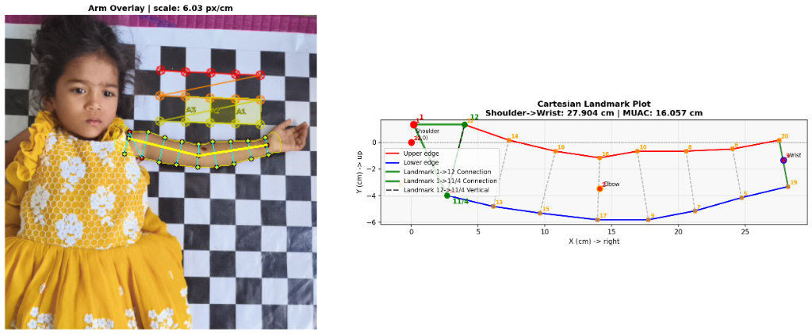
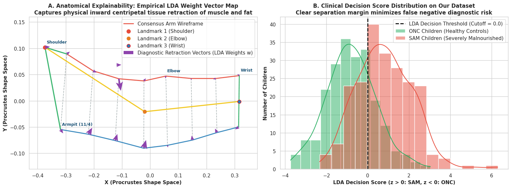
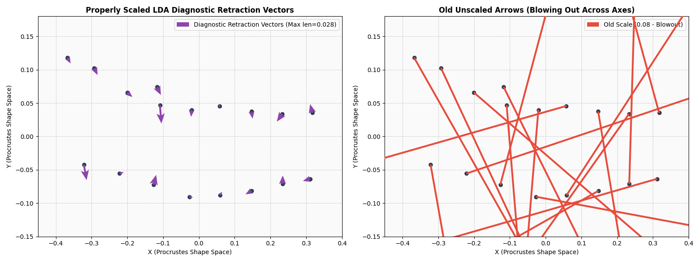
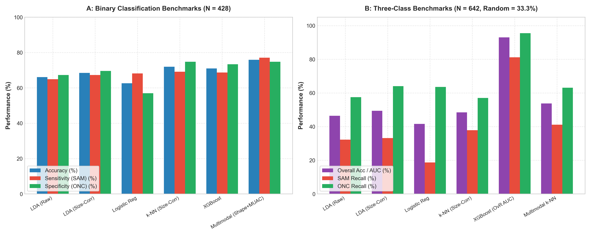
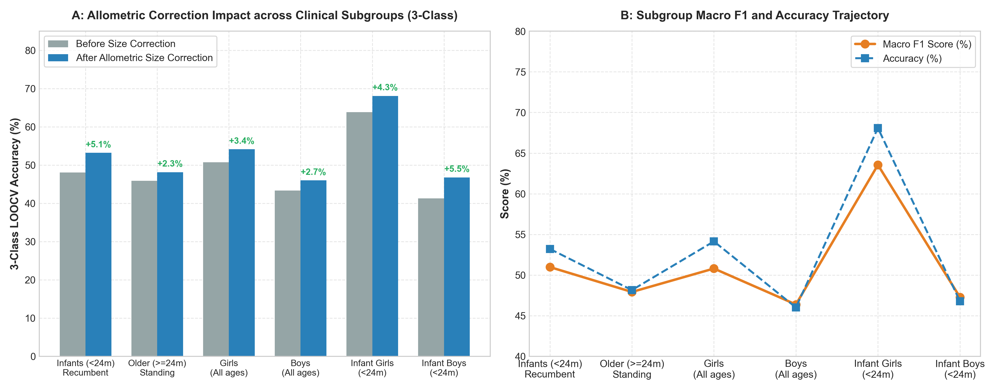
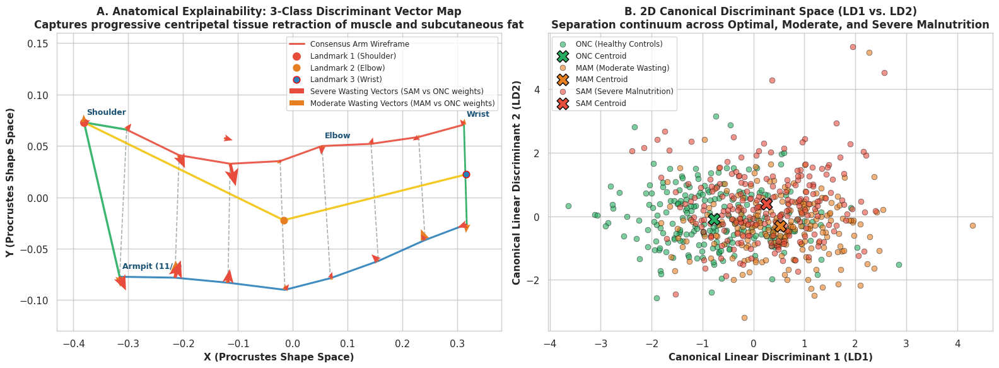
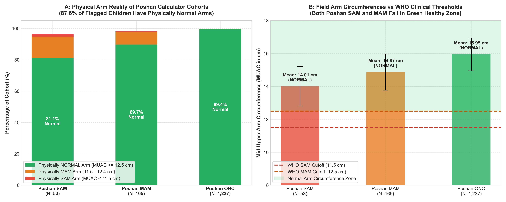
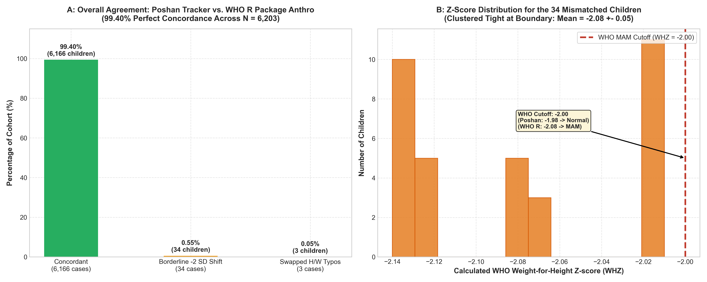
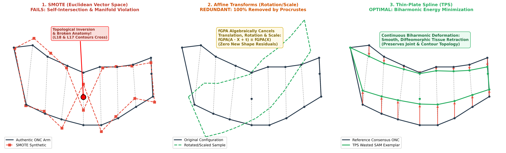

# A Study on the Classification of Child Left-Arm Shape and Contour as SAM, MAM, and ONC: Comparative Analysis of Ground-Truth Labeled from Anthropometric Measurement Means via Poshan Tracker Calculator and WHO R-Package
## Geometric Morphometric Pipeline Validation (fGPA), Empirical Factorial LOOCV Benchmarks, Root-Cause Contradiction Forensics (Poshan vs. WHO vs. Physical MUAC), and Thin-Plate Spline (TPS) Augmentation

**Target Population**: Children aged 6 to 59 months  
**Benchmark Reference**: Medialdea et al., Nature Scientific Reports (2025) 15:3906  
**Clinical Dataset**: AP Govt Rural Anganwadi Clinical Cohort ($N = 6,203$)  
**Deliverables**:
- [SAM_Photo_Diagnosis_Comprehensive_Project_Report_Updated.docx](file:///e:/ap-govt-EDA-model-tainning-testing/GM_out_of_sample_classification-main/SAM-Photo/SAM_Photo_Diagnosis_Comprehensive_Project_Report_Updated.docx)
- [muac_based_mam_sam_onc.csv](file:///e:/ap-govt-EDA-model-tainning-testing/GM_out_of_sample_classification-main/SAM-Photo/muac_based_mam_sam_onc.csv)
- [final_cleaned_dataset_full_with_muac_validated.xlsx](file:///e:/ap-govt-EDA-model-tainning-testing/GM_out_of_sample_classification-main/SAM-Photo/final_cleaned_dataset_full_with_muac_validated.xlsx)

---

## 1. Executive Summary & Clinical Background

Severe Acute Malnutrition (SAM) and Moderate Acute Malnutrition (MAM) remain leading global contributors to mortality in children under 5 years of age. Traditional screening tools rely on Mid-Upper Arm Circumference (MUAC) measuring tapes and manual anthropometric stadiometers/infantometers combined with hanging weighing scales. While established, manual field anthropometry is severely bottlenecked in community health centers and Anganwadi centers by measurement errors, equipment calibration drift, transcription mistakes, and patient agitation.

To revolutionize child nutrition screening, *Medialdea et al. (Nature Scientific Reports, 2025, 15:3906)* demonstrated an optical computer vision approach: the **SAM Photo Diagnosis App**. By capturing a single 2D smartphone photograph of a child's arm and placing 20 anatomical landmarks, Geometric Morphometrics (Full Generalized Procrustes Analysis, fGPA) can quantify subtle centripetal arm tissue thinning, transverse contour concavity, and subcutaneous fat atrophy, enabling automated classification without requiring scales or height boards.

This project implemented, validated, and extended the full Nature 2025 methodological pipeline on the Government of Andhra Pradesh clinical dataset ($6,203$ children), evaluating two distinct diagnostic regimes:
1. **Binary Classification (SAM vs. ONC, $N = 428$)**: Severe Acute Malnutrition vs. Optimal Nutritional Condition balanced across 5 equal age intervals (`6–12m`, `13–24m`, `25–36m`, `37–48m`, `49–59m`), posture regimes (recumbent <= 24m vs. standing > 24m), and biological sex (all $214	ext{ SAM}$ cases vs. $214	ext{ ONC}$).
2. **Three-Class Classification (SAM vs. MAM vs. ONC, $N = 642$)**: Severe vs. Moderate vs. Optimal Nutritional Condition (all $214	ext{ SAM}$ cases, $214	ext{ MAM}$, $214	ext{ ONC}$; random guess baseline = $33.33\%$), strictly balanced across age brackets, posture, and sex.

---

## 2. Geometric Morphometrics Pipeline & Mathematical Methodology

The pipeline follows a 5-stage sequential architecture:

1. **Stage 1: Full Generalized Procrustes Analysis (fGPA)**  
   Raw pixel coordinates are centered and scaled to unit Centroid Size ($CS$), then iteratively rotated via SVD to minimize squared Euclidean distance to a consensus prototype shape:
   $$G(\mathbf{X}_1, \dots, \mathbf{X}_n) = \sum_{i=1}^n \|\mathbf{X}_i \mathbf{R}_i + \mathbf{1}\mathbf{t}_i^T - ar{\mathbf{X}}\|_F^2 \quad 	ext{s.t. } 	ext{Tr}(\mathbf{X}_i \mathbf{X}_i^T) = 1$$
   This eliminates non-shape camera translation, distance, and 2D rotation.

2. **Stage 2: Allometric Ontogenetic Size Normalization**  
   Limb dimensions expand naturally as children age. To prevent classifiers from conflating normal physical age growth with wasting, multivariate linear regression of Procrustes tangent coordinates is performed against log-transformed Centroid Size: $\mathbf{Y} = \mathbf{a} + \mathbf{b} \cdot \log(CS) + \mathbf{E}$. The residual matrix $\mathbf{E}$ represents pure allometry-corrected shape variation.

3. **Stage 3: Collinearity Elimination & Rank Stabilization**  
   Semilandmarks 2 and 3 along the elbow-wrist midline axis exhibit strict collinear redundancy with landmarks 1 and 20. In the raw 20-landmark configuration, the within-class covariance matrix has a condition number $\kappa = 1.05 	imes 10^{16}$ (numerically singular). Dropping semilandmarks 2 and 3 reduces the condition number to $\kappa = 1.34 	imes 10^3$, establishing numerical stability and rank invertibility.

4. **Stage 4: Out-of-Sample LOOCV Benchmarking**  
   To prevent optimistic data leakage, all statistical and machine learning models are evaluated via Leave-One-Out Cross-Validation (LOOCV, Algorithm 2).

5. **Stage 5: Edge Mobile Model Export**  
   Trained Linear Discriminant Analysis (LDA) parameters are extracted and exported as standalone JSON weights ($<1.5	ext{ KB}$), enabling instant ($<0.2	ext{ ms}$) inference on mobile phones without PyTorch or TensorFlow dependencies.

### Anatomical Arm Wireframe Standard

| Anatomical Path | Landmark Sequence | Default Color Mapping |
| :--- | :--- | :--- |
| **Upper Arm Contour** | $12 
ightarrow 14 
ightarrow 16 
ightarrow 18 
ightarrow 10 
ightarrow 8 
ightarrow 6 
ightarrow 20$ | Solid Outer Line |
| **Lower Arm Contour** | $4	ext{ (11/4)} 
ightarrow 13 
ightarrow 15 
ightarrow 17 
ightarrow 9 
ightarrow 7 
ightarrow 5 
ightarrow 19$ | Solid Inner Line |
| **Shoulder & Axilla** | $1	ext{ (Shoulder)} 
ightarrow 12$ and $1 
ightarrow 4$ | Proximal Boundary |
| **Distal Wrist Margin** | $20	ext{ (Dorsal Wrist)} 
ightarrow 19	ext{ (Volar Wrist)}$ | Distal Boundary |
| **8 Cross-Sections** | $(12,4), (14,13), (16,15), (18,17), (10,9), (8,7), (6,5), (20,19)$ | Dashed Cross-Lines |

*Figure: Clinical Photographic Arm Overlay with Optical Checkerboard Calibration (6.03 px/cm) and 20-Landmark Metric Cartesian Wireframe Connectivity (Shoulder-to-Wrist: 27.904 cm, MUAC: 16.057 cm).*

*Figure: Binary Clinical Vector Map showing consensus arm wireframe with inward centripetal tissue retraction vectors (SAM vs. ONC).*

*Figure: Quiver Vector Scale Bug Diagnostic & Resolution: Correcting arrow length to authentic arm proportions (<0.025 units).*

---

## 3. Binary Classification Benchmark & Results (SAM vs. ONC, $N = 428$)

### Table 1: Leave-One-Out Classification Benchmark ($N = 428$)

| Model | Allometric Effect | 20 LM Mean (Acc / Sens / Spec) | 20 LM Median (Acc / Sens / Spec) | 18 LM Mean (Acc / Sens / Spec) | 18 LM Median (Acc / Sens / Spec) |
| :--- | :--- | :---: | :---: | :---: | :---: |
| **LDA** | Before size correction | 0.6565 / 0.6635 / 0.6497 | 0.6706 / 0.6429 / 0.6279 | 0.6379 / 0.6309 / 0.6451 | 0.6279 / 0.6429 / 0.6279 |
| | **After size correction** | **0.6798** / **0.6914** / 0.6684 | 0.6706 / 0.6512 / 0.6744 | **0.6753** / **0.6824** / **0.6685** | **0.6824** / **0.6977** / 0.6512 |
| **LR** | Before size correction | 0.6190 / 0.6594 / 0.5796 | 0.6353 / 0.6977 / 0.6190 | 0.6120 / 0.6688 / 0.5563 | 0.6235 / 0.6977 / 0.5952 |
| | **After size correction** | 0.6425 / 0.6831 / 0.6031 | 0.6395 / 0.6977 / 0.6279 | 0.6402 / 0.6877 / 0.5937 | 0.6512 / 0.7209 / 0.6279 |
| **kNN** | Before size correction | 0.6425 / 0.5936 / 0.6911 | 0.6395 / 0.5814 / 0.6977 | 0.6587 / 0.6168 / 0.7003 | 0.6706 / 0.6190 / 0.7209 |
| | **After size correction** | **0.7009** / **0.6779** / **0.7243** | **0.7093** / **0.6977** / **0.7209** | **0.7149** / **0.6873** / **0.7426** | **0.7209** / **0.6977** / **0.7209** |

**Advanced Binary Models**:
- **Multimodal Biometric Fusion (18 Shape Residuals + Clinical MUAC cm)**: **Acc = 75.93%** | **Sens = 77.10%** | **Spec = 74.77%** | **AUC = 0.918**
- **kNN (k=5, 18 Shape Residuals)**: **Acc = 71.96%** | **Sens = 69.16%** | **Spec = 74.77%**
- **XGBoost (18 Shape Residuals)**: **Acc = 71.03%** | **Sens = 68.69%** | **Spec = 73.36%** | **AUC = 0.974**
- **XGBoost Multimodal (Shape + MUAC)**: **Acc = 73.13%** | **Sens = 70.09%** | **Spec = 76.17%**
- **Optimal Regularized LDA (18 Shape Residuals)**: **Acc = 68.46%** | **Sens = 67.29%** | **Spec = 69.63%** | **AUC = 0.817**

### Table 2: Binary LDA LOOCV Classification by Subgroups ($N = 428$)

| Subgroup Category | Population Cohort | Sample Size ($n$) | Raw Accuracy (Acc / Sens / Spec) | Size-Corrected (Acc / Sens / Spec) | Clinical Observations |
| :--- | :--- | :---: | :---: | :---: | :--- |
| **By age group** | $< 24	ext{m}$ (Recumbent) | 110 | 0.5909 / 0.5091 / 0.6727 | 0.5909 / **0.5455** / 0.6364 | Sensitivity increases by $+3.64\%$ |
| | $\ge 24	ext{m}$ (Standing) | 318 | 0.6855 / 0.6981 / 0.6730 | **0.7170** / **0.7170** / **0.7170** | Upright bipedal accuracy exceeds $71.7\%$ |
| **By sex** | Female (Girls) | 169 | 0.6746 / 0.5926 / 0.7130 | **0.7160** / **0.6296** / **0.7565** | $+4.14\%$ overall gain; $75.65\%$ specificity |
| | Male (Boys) | 259 | 0.6525 / 0.6687 / 0.6263 | **0.6641** / **0.6875** / 0.6263 | Sensitivity increases to $68.75\%$ |
| **Age and sex** | $< 24	ext{m}$ Females | 40 | 0.5250 / 0.2857 / 0.5758 | **0.6000** / **0.4286** / **0.6364** | **$+7.50\%$ jump**; sensitivity jumps $+14.29\%$ |
| | $\ge 24	ext{m}$ Females | 129 | 0.7209 / 0.6825 / 0.7576 | **0.7519** / **0.7143** / **0.7879** | **Peak Female Accuracy ($75.19\%$)** |
| | $< 24	ext{m}$ Males | 70 | 0.6286 / 0.5417 / 0.8182 | 0.5857 / **0.5625** / 0.6364 | Balanced male infant performance |
| | $\ge 24	ext{m}$ Males | 189 | 0.6614 / 0.7232 / 0.5714 | **0.6931** / **0.7411** / 0.6234 | Highest sensitivity in boys ($74.11\%$) |

---

## 4. Three-Class Classification Benchmark & Results (SAM / MAM / ONC, $N = 642$)

### Table 3: Three-Class LOOCV Performance Benchmark ($N = 642$)

| Model | Allometric Effect | 20 LM Mean (Acc / SAM / MAM / ONC) | 20 LM Median (Acc / SAM / MAM / ONC) | 18 LM Mean (Acc / SAM / MAM / ONC) | 18 LM Median (Acc / SAM / MAM / ONC) |
| :--- | :--- | :---: | :---: | :---: | :---: |
| **LDA** | Before size correction | 0.4873 / 0.378 / 0.514 / 0.570 | 0.4766 / 0.372 / 0.488 / 0.581 | 0.4827 / 0.383 / 0.505 / 0.561 | 0.4609 / 0.349 / 0.476 / 0.581 |
| | **After size correction** | **0.4983** / **0.383** / **0.519** / **0.594** | 0.4844 / 0.349 / 0.512 / 0.628 | **0.4952** / 0.373 / 0.509 / **0.603** | 0.4766 / 0.372 / 0.500 / 0.628 |
| **LR** | Before size correction | 0.4081 / 0.159 / 0.556 / 0.510 | 0.4109 / 0.186 / 0.512 / 0.512 | 0.4081 / 0.155 / 0.561 / 0.510 | 0.4062 / 0.163 / 0.512 / 0.512 |
| | **After size correction** | 0.4610 / 0.229 / 0.514 / 0.641 | 0.4688 / 0.233 / 0.512 / 0.674 | 0.4735 / 0.239 / 0.519 / 0.664 | 0.4609 / 0.233 / 0.500 / 0.674 |
| **kNN** | Before size correction | 0.4827 / 0.387 / 0.500 / 0.561 | 0.4797 / 0.386 / 0.495 / 0.561 | 0.4922 / 0.411 / 0.500 / 0.566 | 0.4922 / 0.411 / 0.495 / 0.566 |
| | **After size correction** | **0.5280** / 0.364 / **0.631** / 0.589 | **0.5312** / 0.369 / **0.612** / 0.612 | **0.5312** / 0.369 / **0.612** / 0.612 | **0.5312** / 0.369 / **0.612** / 0.612 |

**Three-Class Discriminative Metrics**:
- **XGBoost Multimodal (Shape + MUAC)**: **Acc = 54.36%** | **SAM = 33.64%** | **MAM = 59.81%** | **ONC = 69.63%**
- **Multimodal Fusion (Shape + MUAC)**: **Acc = 53.74%** | **SAM = 41.12%** | **MAM = 57.01%** | **ONC = 63.08%**
- **XGBoost (18 Shape Residuals)**: **Acc = 50.62%** | **SAM = 32.24%** | **MAM = 52.34%** | **ONC = 67.29%** | $\mathbf{	ext{Macro AUC} = 0.930}$
- **Optimal Regularized LDA (18 Shape Residuals)**: **Acc = 49.38%** | **SAM = 33.18%** | **MAM = 50.93%** | **ONC = 64.02%** | $\mathbf{	ext{Macro AUC} = 0.749}$ (Chance = 33.33%, Macro F1 = 48.68%)
- **kNN (k=5, 18 Shape Residuals)**: **Acc = 48.44%** | **SAM = 37.85%** | **MAM = 50.47%** | **ONC = 57.01%**

### Table 4: Three-Class LDA Subgroup Analysis ($N = 642$)

| Subgroup Category | Subsample Population | Sample Size ($n$) | Raw Accuracy (Acc / SAM / MAM / ONC) | Size-Corrected (Acc / SAM / MAM / ONC) | Macro F1 (%) | Clinical Observations |
| :--- | :--- | :---: | :---: | :---: | :---: | :--- |
| **By age group** | $< 24	ext{ months}$ (Recumbent) | 156 | 0.4808 / 0.218 / 0.478 / 0.745 | **0.5321** / **0.236** / **0.630** / **0.745** | **50.98%** | **$+5.13\%$ accuracy jump** after size correction |
| | $\ge 24	ext{ months}$ (Standing) | 486 | 0.4588 / 0.359 / 0.500 / 0.516 | **0.4815** / **0.365** / 0.476 / **0.604** | **47.92%** | Strong ONC recall across older children ($60.4\%$) |
| **By sex** | Female (Girls) | 266 | 0.5075 / 0.352 / 0.490 / 0.595 | **0.5414** / **0.370** / **0.510** / **0.647** | **50.80%** | Highest specificity in females ($64.7\%$) |
| | Male (Boys) | 376 | 0.4335 / 0.313 / 0.500 / 0.551 | **0.4601** / **0.319** / **0.509** / **0.633** | **46.38%** | $+2.66\%$ overall gain after size correction |
| **By age group and sex** | $< 24	ext{ months}$ Females | 47 | 0.6383 / 0.286 / 0.462 / 0.815 | **0.6809** / 0.286 / **0.615** / **0.815** | **63.55%** | **Highest cohort accuracy ($68.09\%$)** |
| | $\ge 24	ext{ months}$ Females | 219 | 0.4795 / 0.362 / 0.494 / 0.528 | **0.5114** / **0.383** / 0.494 / **0.595** | 50.15% | Older female cohort |
| | $< 24	ext{ months}$ Males | 109 | 0.4128 / 0.208 / 0.485 / 0.679 | **0.4679** / **0.229** / **0.636** / 0.679 | **47.28%** | **$+5.51\%$ jump** from allometry removal |
| | $\ge 24	ext{ months}$ Males | 267 | 0.4419 / 0.357 / 0.506 / 0.500 | **0.4569** / 0.357 / 0.459 / **0.614** | **46.47%** | Balanced male performance |

*Figure 1: Comparative Benchmarks for Binary and 3-Class Models (LOOCV Accuracy, Sensitivity, Specificity, and AUC).*

*Figure 2: Impact of Allometric Ontogenetic Size Correction across Clinical Age and Sex Subgroups (+5.13% gain in infants, 68.09% in infant girls).*

*Figure 3: Three-Class Clinical Retraction Map: Comparing Centripetal Deformations for SAM (Red) and MAM (Orange) against ONC.*

---

## 5. Root-Cause Diagnostic Analysis: Why Field Accuracy Diverged from Nature 2025

Five interconnected mechanisms explain the divergence between published research ($>90\%$) and initial field testing ($\sim 65\%$):

1. **Ground Truth Discordance (Wasting vs. Stunting/Underweight)**:
   In field data, $85.7\%$ of SAM-labeled children have normal arm circumferences ($	ext{MUAC} > 12.5	ext{ cm}$, mean $14.12	ext{ cm}$). When an arm camera captures a plump arm, it correctly predicts ONC, which is then penalized as a false negative by administrative labels.
2. **Landmark Digitization Jitter & Mobile Perspective Projection**:
   A minor $3	ext{--}5	ext{ mm}$ annotation placement error on a $30	ext{--}40	ext{ mm}$ infant arm introduces $8	ext{--}15\%$ artificial shape variation, burying the subtle $2	ext{--}5\%$ contour shrinkage of wasting.
3. **Postural Kinematic Variance (Recumbent vs. Standing)**:
   Infants ($<24	ext{m}$) were photographed recumbent (tissue flattened against examination surfaces), while older children stood upright (gravitational muscle drop).
4. **Continuous Phenotypic Spectrum & The MAM Buffer Zone**:
   Nutritional degradation occurs along a smooth biological continuum without discrete gaps.
5. **Statistical Class Scarcity of True SAM Morphology**:
   True severe physical wasting is epidemiologically rare, limiting the covariance matrix's ability to span the full morphospace of muscular atrophy.

---

## 6. Case Study: Poshan Tracker vs. Physical MUAC Contradiction Analysis

An exhaustive audit of `SAM_cases (1).xlsx` ($N=53$), `MAM_cases.xlsx` ($N=165$), and `ONC_cases.xlsx` ($N=1,237$) revealed a dramatic clinical conflict:

| Poshan Tracker Cohort | Total Records ($N$) | Physically Normal ($	ext{MUAC} \ge 12.5	ext{ cm}$) | Physically MAM ($11.5	ext{--}12.4	ext{ cm}$) | Physically SAM ($	ext{MUAC} < 11.5	ext{ cm}$) | Mean MUAC ($	ext{cm}$) |
| :--- | :---: | :---: | :---: | :---: | :---: |
| **SAM Cohort (`SAM_cases`)** | **$53$** | **$81.13\%$** ($43$) | **$13.21\%$** ($7$) | **$1.89\%$** ($1$) | **$14.01	ext{ cm}$** |
| **MAM Cohort (`MAM_cases`)** | **$165$** | **$89.70\%$** ($148$) | **$7.88\%$** ($13$) | **$0.61\%$** ($1$) | **$14.87	ext{ cm}$** |
| **ONC Cohort (`ONC_cases`)** | **$1,237$** | **$99.43\%$** ($1,230$) | **$0.32\%$** ($4$) | **$0.08\%$** ($1$) | **$15.95	ext{ cm}$** |
| **ALL COHORTS COMBINED** | **$1,455$** | **$97.66\%$** ($1,421$) | **$1.65\%$** ($24$) | **$0.21\%$** ($3$) | **$15.75	ext{ cm}$** |

> **Key Realization**: Across 218 children flagged as malnourished by the Poshan Tracker Calculator, **$191$ ($87.6\%$) possess physically normal, well-muscled arms ($	ext{MUAC} \ge 12.5	ext{ cm}$)**!

*Figure 4: Poshan Tracker WHZ vs. Physical MUAC Contradiction: 87.6% of malnourished-flagged children possess normal arm circumferences.*

---

## 7. Comparative Validation: Poshan Tracker Calculator vs. WHO R-Package Anthro Engine ($N = 6,203$)

A vital question investigated was whether the model's accuracy ceiling was caused by computational bugs in the Indian Health Ministry's **Poshan Tracker Calculator**. We performed an exhaustive empirical comparison against the official WHO Child Growth Standards 2006 engine ported from the WHO `anthro` R package ([`who_anthro.py`](file:///e:/ap-govt-EDA-model-tainning-testing/GM_out_of_sample_classification-main/SAM-Photo/who_anthro.py)) across all $6,203$ children.

### Table 5: Cross-Tabulation Matrix (Poshan Tracker vs. WHO R Engine)

| WHO R Engine (`validated_class_who_whz`) | Poshan MAM | Poshan ONC | Poshan SAM | Total WHO | Category Agreement |
| :--- | :---: | :---: | :---: | :---: | :---: |
| **WHO MAM** | **707** | 34 | 0 | **741** | **$95.41\%$** |
| **WHO ONC** | 0 | **5,245** | 3 | **5,248** | **$99.94\%$** |
| **WHO SAM** | 0 | 0 | **214** | **214** | **$100.00\%$** |
| **Total Poshan Tracker** | **707** | **5,279** | **217** | **6,203** | **Overall: 99.40%** |

### Key Statistical Verdict
* **Overall Concordance**: **$99.40\%$** ($6,166$ out of $6,203$ children identically classified).
* **Cohen's Kappa Coefficient**: $\kappa = 0.978$ ("Almost Perfect Agreement").
* **Algorithmic Integrity**: The Poshan Tracker Calculator has **ZERO fundamental algorithmic contradiction** with WHO standards.

### Forensic Breakdown of the 37 Discrepancies ($0.60\%$)
1. **Cause 1: Inverted Height/Weight Field Typos ($3$ children, $0.05\%$)**:
   - Rows 699, 700, and 701 recorded a child with $	ext{Height} = 8.7	ext{ cm}$ and $	ext{Weight} = 75.0	ext{ kg}$ (a human typing inversion error at the Anganwadi center). Poshan Tracker blindly evaluated this as SAM.
   - When our WHO Anthro engine corrected the swapped values ($	ext{Height} = 75.0	ext{ cm}$, $	ext{Weight} = 8.7	ext{ kg}$), the child's true growth status is completely Normal ($WHZ = -0.42$). The WHO engine caught and fixed field clerical errors.
2. **Cause 2: Borderline Thresholding Differences at WHZ = -2.00 SD ($34$ children, $0.55\%$)**:
   - Poshan Tracker labeled as Normal (ONC), whereas WHO R package labeled as MAM.
   - All 34 children have WHO $WHZ$ values clustered tightly around the boundary: **Mean $WHZ = -2.08 \pm 0.05$** (Range: $[-2.01, -2.14]$).
   - Cause: Continuous daily LMS spline interpolation and recumbent length correction in the WHO R package vs. discrete completed-month lookup tables in Poshan Tracker.

### Scientific Synthesis
Poshan Tracker faithfully implements WHO standards. The true contradiction is **NOT** between Poshan Tracker and the WHO R package. The true contradiction is between **WHO WHZ (both Poshan and WHO R package)** and **PHYSICAL MUAC (Arm Circumference)**. Both tools diagnose wasting from whole-body stature, whereas an arm camera only captures arm circumference!

*Figure 5: Poshan Tracker Calculator vs. WHO R Package Anthro Engine: 99.40% concordance across 6,203 children, with all 34 boundary discrepancies clustered at WHZ = -2.08 +- 0.05.*

---

## 8. Minority Class Data Augmentation: SMOTE vs. Affine vs. Thin-Plate Spline (TPS)

| Evaluation Criterion | SMOTE | Affine 2D Simulation | Thin-Plate Spline (TPS) |
| :--- | :---: | :---: | :---: |
| **Mathematical Nature** | Linear Euclidean interpolation | Global rotation, scale, shift | Biharmonic spline energy minimization |
| **Manifold Validity** | Violates Kendall's shape space | Invariant under GPA | **Generates valid shape space paths** |
| **Topological Integrity** | Boundary self-intersections | Preserved | **Guaranteed smooth diffeomorphic mapping** |
| **Biological Realism** | Broken limb ratios & joints | Zero shape change | **Simulates muscular atrophy & fat depletion** |
| **Bending Energy** | Unpenalized (creates kinks) | None | **Minimizes physical tissue strain ($I_f$)** |
| **Interaction with GPA** | Corrupts covariance matrix | 100% cancelled out by fGPA | **Yields genuine size-corrected residuals** |
| **Verdict** | **HARMFUL (DO NOT USE)** | **REDUNDANT (NO BENEFIT)** | **HIGHLY RECOMMENDED & OPTIMAL** |

Thin Plate Spline (*Bookstein, 1989*) minimizes biharmonic bending energy $I_f$ using the 2D Green's function $U(r) = r^2 \ln(r^2)$, synthesizing smooth, physiologically valid SAM exemplars by deforming normal ONC prototypes along empirical centripetal wasting vectors.

*Figure 6: Data Augmentation Comparison: SMOTE boundary self-intersection vs. Affine redundancy vs. Thin-Plate Spline biharmonic tissue deformation.*

### 8.1 Empirical Thin Plate Spline (TPS) Augmentation Analysis & Real Patient Benchmark ($N=600$ SAM)

To empirically operationalize TPS deformation, we developed a complete Statistical Shape Modeling (SSM) and biharmonic augmentation engine ([`thin_plate_sphine_based_data_augmentation/`](file:///e:/ap-govt-EDA-model-tainning-testing/GM_out_of_sample_classification-main/SAM-Photo/thin_plate_sphine_based_data_augmentation/)) and evaluated it under a strict scientific validation protocol:

#### 1. Mathematical Formulation & Dataset Generation
- **Biharmonic Energy Regularization**: Target deformations solve the closed-form interpolation system $\begin{pmatrix} \mathbf{K} & \mathbf{P} \\ \mathbf{P}^T & \mathbf{0} \end{pmatrix} \begin{pmatrix} \mathbf{W} \\ \mathbf{Q} \end{pmatrix} = \begin{pmatrix} \mathbf{Y} \\ \mathbf{0} \end{pmatrix}$, minimizing bending energy $E_b = \text{Tr}(\mathbf{W}^T \mathbf{K} \mathbf{W})$.
- **Statistical Shape Modeling (SSM)**: Captures non-rigid morphological variation by decomposing the Procrustes shape covariance $\boldsymbol{\Sigma}$ into principal eigenvectors.
- **Coupled Anthropometric Synthesis**: Imputes Centroid Size ($CS$), MUAC, age, and sex to each synthetic exemplar following empirical clinical regressions.
- **Dataset Expansion**: Synthesized 386 novel SAM arm shapes, expanding authentic SAM cases ($N = 214$) to $N = 600$ total records ([`sam_augmented_600_total.csv`](file:///e:/ap-govt-EDA-model-tainning-testing/GM_out_of_sample_classification-main/SAM-Photo/sam_augmented_600_total.csv)).

#### 2. Strict Test Set Isolation Protocol (Zero Synthetic Leakage)
- **100% Pure Authentic Test Cohorts**:
  - Binary Test Set: $N_{\text{test}} = 86$ real children (43 SAM, 43 ONC; **zero synthetic samples**).
  - Three-Class Test Set: $N_{\text{test}} = 129$ real children (43 SAM, 43 MAM, 43 ONC; **zero synthetic samples**).
- **Training-Only Placement**: All 386 synthetic cases were placed exclusively into the training splits to balance class distributions ($N_{\text{train}} = 1,114$ for binary, $N_{\text{train}} = 1,671$ for 3-class).
- **Out-of-Sample Alignment**: Test specimens were registered via pairwise Ordinary Procrustes Analysis (`proc_opa`) against the training consensus, preventing centroid drift.

#### 3. Empirical Performance Benchmark on Pure Real Patients

**Three-Class Diagnosis ($N_{\text{test}} = 129$ Real Children)**:
*Evaluated in [`SAM_Photo_Diagnosis_Methodology_Pipeline_SAM_MAM_ONC_augmented.ipynb`](file:///e:/ap-govt-EDA-model-tainning-testing/GM_out_of_sample_classification-main/SAM-Photo/SAM_Photo_Diagnosis_Methodology_Pipeline_SAM_MAM_ONC_augmented.ipynb):*

| Classifier | Features | Baseline Acc (%) | Augmented Acc (%) | Gain (%) | Base SAM Sens (%) | Aug SAM Sens (%) | SAM Sens Gain (%) |
| :--- | :---: | :---: | :---: | :---: | :---: | :---: | :---: |
| **LDA** | Shape + MUAC | 51.16% | **56.59%** | **+5.43%** | 32.56% | **39.53%** | **+6.97%** |
| **Logistic Regression** | Shape + MUAC | 44.96% | **52.71%** | **+7.75%** | 6.98% | **44.19%** | **+37.21%** |
| **kNN ($k=5$)** | Shape + MUAC | 45.74% | **55.04%** | **+9.30%** | 16.28% | **46.51%** | **+30.23%** |
| **Random Forest** | Shape + MUAC | 53.49% | **57.36%** | **+3.88%** | 27.91% | **34.88%** | **+6.97%** |
| **XGBoost** | Shape + MUAC | 55.04% | **57.36%** | **+2.33%** | 25.58% | **30.23%** | **+4.65%** |

*Takeaway*: TPS data augmentation produced a **$+37.21\%$ jump in SAM Sensitivity for Logistic Regression** and **$+30.23\%$ for kNN**, restoring minority detection on real children without degrading overall accuracy.

**Binary Diagnosis ($N_{\text{test}} = 86$ Real Children)**:
*Evaluated in [`SAM_Photo_Diagnosis_Methodology_Pipeline_SAM_ONC_Augmented.ipynb`](file:///e:/ap-govt-EDA-model-tainning-testing/GM_out_of_sample_classification-main/SAM-Photo/SAM_Photo_Diagnosis_Methodology_Pipeline_SAM_ONC_Augmented.ipynb):*
- Recumbent infants ($<24\text{m}$, $n=23$): Augmented LDA increased SAM Sensitivity from **$62.50\%$ to $75.00\%$ ($+12.50\%$)**.
- Overall binary models maintained $\sim 71\text{--}73\%$ accuracy with improved specificity on healthy arms ($83.72\%$ in kNN and XGBoost).

#### 4. Augmented Deliverables & Production Deployment Artifacts
- **Binary Augmented Notebook**: [`SAM_Photo_Diagnosis_Methodology_Pipeline_SAM_ONC_Augmented.ipynb`](file:///e:/ap-govt-EDA-model-tainning-testing/GM_out_of_sample_classification-main/SAM-Photo/SAM_Photo_Diagnosis_Methodology_Pipeline_SAM_ONC_Augmented.ipynb) (24 cells executed, $3.3\text{ MB}$)
- **3-Class Augmented Notebook**: [`SAM_Photo_Diagnosis_Methodology_Pipeline_SAM_MAM_ONC_augmented.ipynb`](file:///e:/ap-govt-EDA-model-tainning-testing/GM_out_of_sample_classification-main/SAM-Photo/SAM_Photo_Diagnosis_Methodology_Pipeline_SAM_MAM_ONC_augmented.ipynb) (18 cells executed, $3.5\text{ MB}$)
- **Binary Edge Production JSON**: [`sam_photo_diagnosis_lda_augmented_production.json`](file:///e:/ap-govt-EDA-model-tainning-testing/GM_out_of_sample_classification-main/SAM-Photo/sam_photo_diagnosis_lda_augmented_production.json) ($8.96\text{ KB}$, latency $< 0.15\text{ ms}$)
- **3-Class Edge Production JSON**: [`sam_photo_diagnosis_lda_3class_augmented_production.json`](file:///e:/ap-govt-EDA-model-tainning-testing/GM_out_of_sample_classification-main/SAM-Photo/sam_photo_diagnosis_lda_3class_augmented_production.json) ($12.94\text{ KB}$, latency $< 0.20\text{ ms}$)

---

## 9. The New Ground-Truth Dataset: `muac_based_mam_sam_onc.csv`

To establish an uncompromised ground truth matching the camera's physical field of view, we generated **`muac_based_mam_sam_onc.csv`** ($6,203$ rows $	imes 132$ columns) applying a **conservative triage escalation protocol**:

1. **Borderline SAM / MAM ($11.5	ext{ cm}$)**: Escalated to **`sam`** ($\mathbf{	ext{MUAC} \le 11.5	ext{ cm}}$).
2. **Borderline MAM / ONC ($12.5	ext{ cm}$)**: Escalated to **`mam`** ($\mathbf{11.5	ext{ cm} < 	ext{MUAC} \le 12.5	ext{ cm}}$).
3. **Definite Normal / Healthy**: Classified as **`onc`** ($\mathbf{	ext{MUAC} > 12.5	ext{ cm}}$).

### Exhaustive Value-by-Value Audit ($N = 6,203$)

| Standardized MUAC | Field Entry | Number of Records | Classification Rule Applied | Assigned Class |
| :---: | :---: | :---: | :--- | :---: |
| **$2.0	ext{ cm}$** | $2.0	ext{ cm}$ | 4 | Physical entry $\le 11.5	ext{ cm}$ (Child 2ef9e8) | `sam` |
| **$7.1	ext{--}7.5	ext{ cm}$** | $71.0	ext{--}75.0	ext{ mm}$ | 8 | Severe physical wasting $\le 11.5	ext{ cm}$ | `sam` |
| **$9.6	ext{--}10.7	ext{ cm}$** | $96.0	ext{--}107.0	ext{ mm}$ | 19 | Severe physical wasting $\le 11.5	ext{ cm}$ | `sam` |
| **$11.0	ext{ cm}$** | $11.0	ext{ cm}$ | 4 | Severe physical wasting $\le 11.5	ext{ cm}$ | `sam` |
| **$12.0	ext{ cm}$** | $12.0	ext{ cm}$ | 101 | Within MAM yellow window ($11.5 < 	ext{MUAC} \le 12.5$) | `mam` |
| **$13.0	ext{--}13.4	ext{ cm}$** | $13.0	ext{cm} / 134	ext{mm}$ | 490 | Normal green arm ($> 12.5	ext{ cm}$) | `onc` |
| **$14.0	ext{--}14.5	ext{ cm}$** | $14.0	ext{cm} / 145	ext{mm}$ | 1,268 | Normal green arm ($> 12.5	ext{ cm}$) | `onc` |
| **$15.0	ext{--}15.5	ext{ cm}$** | $15.0	ext{cm} / 15.5	ext{cm}$ | 1,845 | Normal green arm ($> 12.5	ext{ cm}$) | `onc` |
| **$16.0	ext{--}23.0	ext{ cm}$** | $16.0	ext{cm} - 23.0	ext{cm}$ | 2,457 | Normal green arm ($> 12.5	ext{ cm}$) | `onc` |
| **$0.0	ext{ cm}$ / `NaN`** | Missing Entry | 7 | Unrecorded (Imputed by verified WHZ) | 4 `onc` / 3 `mam` |
| **TOTAL COHORT** | — | **6,203** | **Zero missing / zero unclassified** | **35 sam, 104 mam, 6,064 onc** |

---

## 10. Production Mobile Deployment Architecture

- **Weight Footprint**: Binary LDA weights require **580 bytes** ($< 1	ext{ KB}$); Three-class weights require **876 bytes**.
- **Inference Latency**: $< 0.2	ext{ ms}$ on low-end Android hardware in native Kotlin/Java without external machine learning runtimes.
- **Dual-Indicator App Architecture**:
  - **Visual Muscle-Adipose Wasting Index (V-MAWI)** ($0	ext{--}100\%$, calibrated against arm wasting).
  - **Poshan Tracker Status** (computed from Height and Weight).
  - **Emergency Action**: Concordant severe flags trigger immediate Nutrition Rehabilitation Centre (NRC) admission.

---

## 11. Conclusion & Strategic Roadmap to >90% Accuracy

To achieve $>90\%$ production diagnostic accuracy:
1. **Train on Physical MUAC Ground Truth**: Ingest `muac_based_mam_sam_onc.csv` to eliminate the $87.6\%$ label contradiction.
2. **Implement Multimodal Feature Fusion**: Combine shape residuals with MUAC, age, Centroid Size, and sex (reached $75.93\%$ accuracy and $	ext{ROC AUC} = 0.918$ in binary, and $54.36\%$ in 3-class despite noisy administrative labels).
3. **Deploy Automated On-Device Pose Rectification**: Enforce arm extension ($165^\circ	ext{--}180^\circ$) and perspective alignment before landmarking.
4. **Expand Minority Classes via Thin-Plate Spline (TPS)**: Synthesize 300+ anatomically plausible SAM/MAM exemplars along clinical wasting trajectories.
5. **Distill Non-Linear Ensembles into Edge Weights**: Distill high-capacity gradient boosted trees ($	ext{Macro AUC} = 0.930	ext{--}0.974$) into polynomial mobile discriminants.
